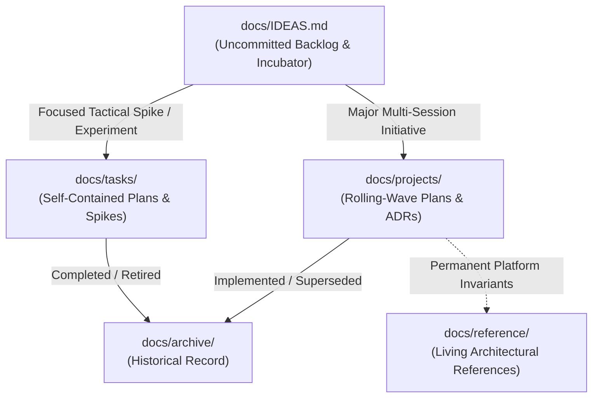

# Roadtrip Co-Pilot: Documentation Architecture & Knowledge Base

This directory houses all engineering specifications, architecture blueprints, research proposals, and tactical implementation plans for **Roadtrip Co-Pilot**.

To ensure that both human developers and AI coding agents have unambiguous context without suffering from plan drift or outdated assumptions, documentation is strictly organized into four functional categories plus an ideas incubator:

---

## The Four Documentation Categories

### 1. [`projects/`](projects/) — Major Multi-Session Initiatives
* **Definition:** Large-scale architectural transformations spanning multiple developer sessions that require structured rolling-wave planning (Tier 1 North Star, Tier 2 Phase Roadmap, Tier 3 Active Work Package) and living Architecture Decision Records (ADRs).
* **Execution Protocol:** Work in this directory strictly adheres to the **Orchestrator-Worker delegation model** (Frontier models orchestrate; `flash` / Gemini 3.8 Flash High implements) as defined in [`AGENTS.md`](../AGENTS.md#6-planning--execution-working-models-large-projects-vs-smaller-tasks).
* **Current Projects:**
  * **[`projects/route-scout-cloud/`](projects/route-scout-cloud/WORKING_MODEL.md) `[ACTIVE — Phase 1]`:** Transitioning Route Scout from local CLI execution to a production AWS cloud architecture with Amazon Bedrock AI, Fastify on Lambda, S3 persistence, and dual-mode Google OIDC auth.
  * **[`projects/android-route-client/`](projects/android-route-client/WORKING_MODEL.md) `[QUEUED — Phase 2]`:** Android on-the-fly offline route editing (Tier 1) and cloud co-pilot client sync (Tier 2). *Strictly blocked until Phase 1 reaches completion.*

### 2. [`reference/`](reference/) — Living Architecture & Platform Invariants
* **Definition:** **Historical but permanently authoritative.** Documents underlying operating system rules, windowing pipeline constraints, audio routing physics, and core design rationales that dictate why the app is built the way it is.
* **Key Files:**
  * **[`reference/android_auto_multitasking_architecture.md`](reference/android_auto_multitasking_architecture.md):** Deep technical breakdown of Android Auto's "Coolwalk" split-screen windowing pipeline, the dual-slot Navigation vs. Media model, and why Roadtrip Co-Pilot must run strictly as a background service with heads-up notifications.

### 3. [`tasks/`](tasks/) — Focused Tactical Spikes & Experiments
* **Definition:** Standalone implementation plans, spike specifications, and proof-of-concept experiments that are self-contained and small enough (typically 1–2 sessions) not to require full 3-tier roadmaps or dedicated ADR indices, but are valuable engineering assets committed to git.
* **Execution Protocol (Lightweight Single-File Model):**
  * **Single-File Truth:** The task markdown file itself acts as both the specification and the active checklist/handoff record (no separate `ROADMAP.md` or `DECISIONS.md` directory overhead).
  * **Quota-Optimized Delegation:** Still adheres to the **Orchestrator-Worker model**—the Frontier Orchestrator manages boundaries, reviews diffs, and runs verification suites, while delegating concrete code/test implementation to `flash` subagents (`invoke_subagent` with `TypeName: 'self'`, `Model: 'flash'`).
  * **Completion & Retirement:** When a tactical task is completed or retired, move its plan file to [`archive/`](archive/) and hoist any newly proven platform invariants into [`reference/`](reference/) or [`AGENTS.md`](../AGENTS.md).
* **Key Files:**
  * **[`tasks/carapp_notification_experiment_implementation_plan.md`](tasks/carapp_notification_experiment_implementation_plan.md):** Detailed implementation plan for testing `androidx.car.app.notification.CarAppExtender` to resolve vehicle launcher conversation-routing issues.

### 4. [`archive/`](archive/) — Completed Historical Proposals & Superseded Specs
* **Definition:** Early research proposals, completed feasibility studies, or superseded architectural drafts preserved strictly for historical posterity.
* **Agent Rule:** **Do not treat archived documents as active roadmaps or source-of-truth specifications.**
* **Key Files:**
  * **[`archive/route_builder_research_and_architecture.md`](archive/route_builder_research_and_architecture.md):** Original research proposal evaluating Web vs. Native Android vs. CLI for the Route Builder. The Web Studio is now in production in `route-builder/` with 200+ passing tests.

### 5. [`IDEAS.md`](IDEAS.md) — Uncommitted Backlog & Incubator
* **Definition:** The holding ground for feature ideas, future enhancements, and user suggestions that have not yet been scoped into active projects or tactical tasks.
