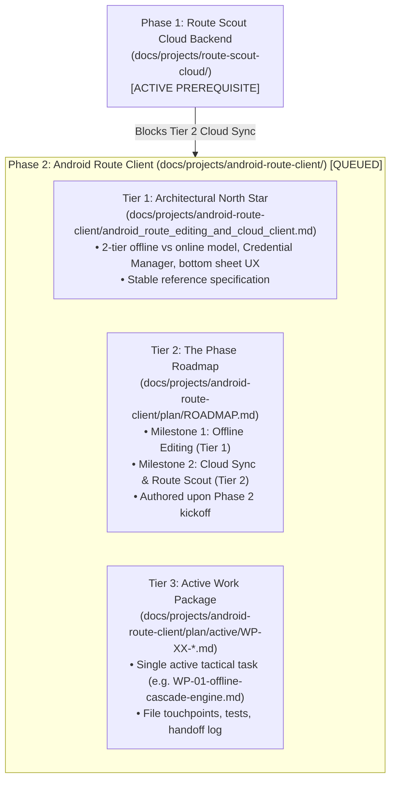

# Android Route Client: Working Model & Execution Protocol

> [!IMPORTANT]
> **Project Status: QUEUED (Phase 2 — Blocked by Cloud Architecture)**  
> This project defines the Android on-the-fly route editing engine and cloud co-pilot client.  
> **Sequencing Rule:** Implementation of Tier 2 (Cloud Sync & Mobile Route Scout) is strictly blocked until the Fastify AWS backend, S3 endpoints, and Google OIDC auth in [`docs/projects/route-scout-cloud/`](../route-scout-cloud/WORKING_MODEL.md) reach their Definition of Done.
>
> **Mandatory Pre-Kickoff Working Model Alignment (STOP BEFORE STARTING):**  
> Our multi-agent orchestration, delegation, and review practices are actively evolving during Phase 1. **Before authoring `plan/ROADMAP.md`, creating `WP-01`, or modifying any Android code for this project, the agent MUST stop and collaborate with the user to review and finalize this `WORKING_MODEL.md`** based on lessons learned from Phase 1. Do not automatically copy or assume the Phase 1 working model without explicit user sign-off.
>
> While Tier 1 (offline Kotlin cascade and Google Maps URL generator) does not require cloud endpoints, active execution across this project is queued so that development efforts remain 100% focused on finishing Phase 1 first.

---

## 1. Project Mission & Two-Tier Architecture

This project evolves the **Roadtrip Co-Pilot Android App (`app/`)** from a read-only itinerary player into an interactive co-pilot supporting:
* **Tier 1 (100% Offline & Free Forever):** Skipping/deleting stops, dwell time adjustments, local schedule cascade recalculations, and dynamic Google Maps URL generation on-device. Operates strictly under **Rule 1** (zero cloud dependencies in the drive loop).
* **Tier 2 (Online Only & Authenticated/Metered):** 2-way S3 cloud itinerary synchronization and conversational Route Scout chat in a native modal bottom sheet.

---

## 2. The 3-Tier Rolling Wave Planning Model

When Phase 2 execution begins, work will follow the standard 3-tier structure:

### Tier 1: The Architectural North Star
* **Location:** [`android_route_editing_and_cloud_client.md`](file:///home/eric/code/roadtrip-copilot/docs/projects/android-route-client/android_route_editing_and_cloud_client.md)
* **Role:** Architectural specification for offline cascade, hot-reloading `CopilotService`, Credential Manager auth, and bottom sheet UI.

### Tier 2: The Phase Roadmap
* **Location:** `docs/projects/android-route-client/plan/ROADMAP.md` *(to be authored upon Phase 2 kickoff)*
* **Role:** Defines exit criteria for Milestone 1 (Offline Editing) and Milestone 2 (Cloud Sync & Route Scout).

### Tier 3: The Active Work Package
* **Location:** `docs/projects/android-route-client/plan/active/WP-XX-<title>.md` *(single active package when in flight)*
* **Role:** Tactical step-by-step checklist, non-goals, affected Kotlin files, Robolectric/JUnit test requirements, and session handoff log.

---

## 3. Architecture Decision Records (ADRs)

All architectural decisions made during the Android client project are indexed in [`DECISIONS.md`](file:///home/eric/code/roadtrip-copilot/docs/projects/android-route-client/DECISIONS.md) and stored in [`decisions/`](file:///home/eric/code/roadtrip-copilot/docs/projects/android-route-client/decisions/).

The project has three foundational decisions pre-recorded:
* [`ADR-0001`](file:///home/eric/code/roadtrip-copilot/docs/projects/android-route-client/decisions/0001-two-tier-offline-core-vs-metered-cloud.md): Two-Tier Architecture (Offline Core vs. Metered Cloud).
* [`ADR-0002`](file:///home/eric/code/roadtrip-copilot/docs/projects/android-route-client/decisions/0002-native-android-credential-manager.md): Native Android Credential Manager for Google OIDC Token Exchange.
* [`ADR-0003`](file:///home/eric/code/roadtrip-copilot/docs/projects/android-route-client/decisions/0003-phone-screen-only-editing-ux.md): Phone-Screen-Only Route Editing & Scout UX (enforcing Android Auto distraction compliance).

---

## 4. Quota-Optimized Orchestrator-Worker Model

As with the cloud project, execution in Phase 2 adheres to the orchestrator-worker delegation hierarchy and the **Two-Gate Quality Protocol** defined in [`route-scout-cloud/WORKING_MODEL.md`](file:///home/eric/code/roadtrip-copilot/docs/projects/route-scout-cloud/WORKING_MODEL.md#two-gate-quality-protocol-preventing-review-churn):
* **Frontier Orchestrator (Primary Agent):**
  * Authors Tier 2 and Tier 3 plans with Gate 1 Contract-First specifications (exact Kotlin interfaces, coroutine dispatcher & cancellation invariants, and negative constraints).
  * Formulates precise interface contracts and Kotlin math algorithms.
  * Ensures Android Auto distraction compliance (Rule 6) and background service battery discipline.
  * Performs Gate 2 Adversarial Diff Audits and executes Android unit & Robolectric tests (`./gradlew testDebugUnitTest`).
* **Subagent Workers (Delegated per active harness adapter):**
  * Porting mathematical engines (`cascade.ts` $\to$ `OfflineCascadeEngine.kt`, `googleMapsUrl.ts` $\to$ `GoogleMapsUrlGenerator.kt`) from explicit orchestrator specifications.
  * Scaffolding XML layouts and ViewBindings (`item_waypoint_row.xml`, `bottom_sheet_scout.xml`).
  * Writing unit and unhappy-path test fixtures and mock responses.

---

## 5. Non-Negotiable Android In-Car Rules
1. **Rule 1 (100% Offline Drive Loop):** Under no circumstances may `CopilotService`, `LocationTracker`, `AudioDuckEngine`, or `NotificationEngine` depend on network calls or wait for cloud responses.
2. **Rule 6 (Android Auto Distraction Constraints):** In-car displays must never render conversational chat inputs or complex editing canvases. All edits take place on the phone and reflect passively on the car display.
