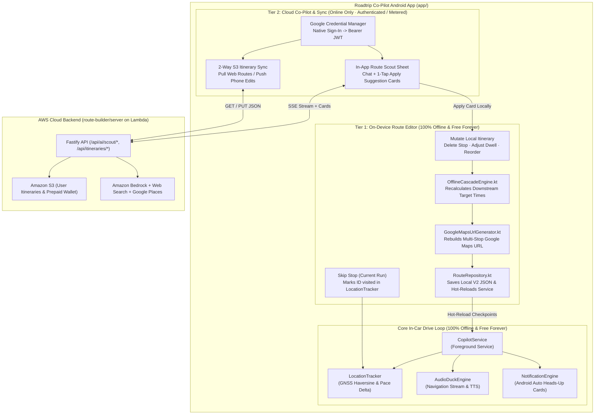

# Android On-the-Fly Route Editing & Cloud Co-Pilot Client Architecture

This document defines the architecture for evolving the **Roadtrip Co-Pilot Android App (`app/`)** from a strictly read-only itinerary player into an interactive co-pilot capable of **on-the-fly route modifications** (both 100% offline and cloud-assisted via Route Scout).

It serves as the companion specification to [route_scout_cloud_architecture.md](../route-scout-cloud/route_scout_cloud_architecture.md).

---

## 1. Real-World Motivation & Architectural Philosophy

During multi-day real-world road trips, itineraries inevitably evolve on the highway:
* Lunch runs 45 minutes late, so you decide to **skip or delete an afternoon viewpoint**.
* You pull into a scenic town and decide to **extend your dwell time** from 15 minutes to 45 minutes, wanting to see how that impacts arrival at your hotel.
* While riding in the passenger seat or stopped for coffee, you want to ask **Route Scout** to find a better lunch spot 30 miles ahead or audit the remaining afternoon stops—without pulling out a laptop, editing in the Web Studio, and re-scanning a QR code.

### Refining the Offline Rule: "Offline-First Core, Cloud-Enhanced Editing"
Historically, the Android app operated as a strictly offline, read-only runtime. To support on-the-fly route modifications without compromising reliability in dead zones (national parks, mountain passes, desert canyons), the Android architecture is structured into two explicit tiers:

### Core Architectural Guardrails
1. **Rule 1 Preserved (Zero Cloud Dependency in the Drive Loop):** `CopilotService`, `LocationTracker`, `AudioDuckEngine`, and `NotificationEngine` **never** make network calls or wait on cloud responses. If cellular connectivity drops to zero, active navigation tracking, spoken TTS alerts, Android Auto heads-up cards, and Tier 1 route edits function at 100% capacity.
2. **Free Core vs. Metered Cloud Tier:**
   * **100% Free Forever:** All in-car co-pilot tracking, QR/SAF route imports, and Tier 1 on-device editing (skipping stops, deleting stops, changing dwell times, local schedule cascading, and regenerating Google Maps links).
   * **Authenticated / Metered Cloud Tier:** Tier 2 features that consume AWS cloud infrastructure or paid AI/Places APIs (in-app Route Scout chat and cloud S3 sync) require signing in with Google and draw from the user's prepaid cloud wallet in Phase 2.

---

## 2. Tier 1: Local On-the-Fly Route Editing (100% Offline & Free)

Deleting a stop, skipping a waypoint, reordering stops, or adjusting dwell time does **not** require an internet connection or an AI model. The Android phone already holds the full V2 `.json` itinerary on disk via `RouteRepository.kt`.

### A. Distinguishing "Skip Stop" vs. "Delete Stop"
On a real road trip, a driver needs two distinct ways to bypass an upcoming stop from the phone's Itinerary card (`MainActivity.kt`):

| Action | Scope | Schedule Cascade Impact | Google Maps Link Impact | Storage Impact |
| :--- | :--- | :--- | :--- | :--- |
| **Skip Stop** *(Temporary)* | Current driving session only | **None** — preserves original planned `target_time` on all subsequent stops (so you can see if skipping the stop helped you catch up to your original schedule!). | Rebuilds the active Google Maps link excluding visited + skipped stops. | Persists the skipped checkpoint ID in `visited_$routeId` (`SharedPreferences`); does **not** alter the `.json` file. |
| **Delete Stop** *(Permanent)* | Modifies the saved day's itinerary | **Cascades downstream times earlier** — subtracts the deleted stop's `dwell_minutes` (and any leg detour delta) from all subsequent stops `k+1..n`. | Rebuilds and saves the day's `google_maps_url` without the deleted stop. | Writes the updated `Itinerary` JSON to `RouteRepository` (`filesDir/itineraries/`) and marks it dirty for cloud sync. |

### B. On-Device Kotlin Engines (Zero Network Required)
To make offline editing self-contained on Android, two lightweight pure-Kotlin engines are ported from `route-builder/src/engine/`:

#### 1. `OfflineCascadeEngine.kt` (Port of `cascade.ts`)
When a user deletes stop $k$, inserts a stop, or modifies `dwell_minutes` on stop $k$ in the Android app:
* **Leg Duration Preservation:** For unchanged adjacent waypoint pairs $(W_i, W_{i+1})$, the engine preserves their existing scheduled driving leg duration (computed from `Arrival_{i+1} - Departure_i` in the V2 JSON, which was originally routed via OSRM).
* **Deleted Stop Bridging:** When stop $k$ is deleted, the new leg $(W_{k-1} \to W_{k+1})$ estimates driving duration offline using the Haversine distance between $W_{k-1}$ and $W_{k+1}$ calibrated against the corridor's average highway speed (or OSRM speed when online), and shifts all downstream `target_time` and `offset_minutes_from_start` values accordingly.
* **Timezone Awareness:** Uses `java.time.ZoneId` and `java.time.ZonedDateTime` (already used in `ItineraryModels.kt`) to format updated local `target_time` strings (`"HH:mm"`) across cross-state timezone boundaries.

#### 2. `GoogleMapsUrlGenerator.kt` (Port of `googleMapsUrl.ts`)
Currently, `ItineraryModels.kt` reads a static `google_maps_url` string baked into the JSON at export time. If you delete a stop on the phone, that static URL still routes Google Maps to the deleted stop!
* By porting the ~120 lines of pure string/URL logic from `route-builder/src/engine/googleMapsUrl.ts` into `GoogleMapsUrlGenerator.kt`:
  1. The Android app filters waypoints using `isPhysicalStop` and `isRouteAnchor` (preserving route-forcing scenic anchors while omitting audio-only `scenic_drive_by` triggers).
  2. Formats queries using decoupled `placeName`, `address`, and `googlePlaceId` (`waypoint_place_ids`).
  3. Automatically partitions legs if intermediate stops exceed 9.
* **Bonus Feature — "Launch Remaining Route in Google Maps":**
  * When you modify a route mid-day (e.g., after passing Stops 1–3, you delete Stop 4), tapping **Open in Google Maps** on the phone can generate a fresh URL containing **only the unvisited remaining checkpoints** (`checkpoints.filter { it.id !in visitedCheckpoints }`), so Google Maps doesn't try to route you back to morning stops you already completed!

### C. Hot-Reloading `CopilotService` & `LocationTracker` Mid-Drive
Inspecting `CopilotService.kt` and `LocationTracker.kt` shows that the app is already 90% wired for live hot-reloading, with two specific refinements required during implementation:
1. **Stable ID Visited State (`LocationTracker.kt`):**
   * `LocationTracker.setCheckpoints()` restores `visitedCheckpoints` by matching `Checkpoint.id` against `visited_$routeKey` in `SharedPreferences`. Because deleting Stop 5 or changing Stop 6's dwell time preserves the `id`s of Stops 1–4, all passed stops automatically remain `PASSED`.
2. **Preserving Live Pace Telemetry Across Hot-Reloads:**
   * Currently, `CopilotService.reloadCheckpoints()` sets the foreground notification to `checkpoints.firstOrNull()` with `"Standby"` before the next GPS fix arrives, and `LocationTracker.setCheckpoints()` resets `lastVisitedPace` to `"In Progress"`.
   * **Refinement:** When `reloadCheckpoints()` is called while a trip is actively running (`visitedCheckpoints.isNotEmpty()`), `LocationTracker` must retain its existing `startTimeMillis` and `lastVisitedPace`, and immediately resolve `nextCheckpoint = checkpoints.firstOrNull { it.id !in visitedCheckpoints }` so the ongoing notification and Android Auto screen update seamlessly without flashing Stop 1.

---

## 3. Tier 2: Cloud-Connected Route Scout & 2-Way Sync on Android (Online)

When the phone has internet connectivity, the Android app becomes a second native client of the AWS Fastify backend defined in [route_scout_cloud_architecture.md](../route-scout-cloud/route_scout_cloud_architecture.md).

### A. Native Authentication via Android Credential Manager
* Instead of opening a web browser cookie flow, the Android app uses the official **Android Credential Manager API (`androidx.credentials` + Google ID)** for 1-tap native Google Sign-In.
* The app exchanges the resulting Google OIDC `id_token` at `POST /api/auth/mobile/google` for a signed Fastify JWT, stored securely in `EncryptedSharedPreferences`.
* Every cloud request from Android attaches `Authorization: Bearer <jwt>`.
* If the user is not signed in (or is offline), the app never nags them—it simply operates in Tier 1 (Offline & Free) mode.

### B. 2-Way Cloud Itinerary Sync (`RouteRepository` + Amazon S3)
* **Local-First Truth for the Drive Loop:** `RouteRepository.kt` continues to store `.json` files in `context.filesDir/itineraries/`. `CopilotService` always reads from local disk so a sudden loss of cell signal never interrupts driving.
* **1-Tap Cloud Pull & Push:**
  * When signed in, the Route Library bottom sheet (`bottom_sheet_routes.xml`) displays a **"Sync with Cloud"** action (and auto-syncs on pull-to-refresh).
  * Itineraries created in the Web Studio are downloaded directly from `GET /api/itineraries` into local storage—eliminating the need to scan QR codes when signed into the same Google account.
  * When a user edits a route on their phone (Tier 1 or Tier 2), `RouteRepository` writes the updated `.json` locally first, then asynchronously `PUT`s the updated JSON to `/api/itineraries/:filename` (backed by S3) so the Web Studio stays in sync.

### C. Mobile Route Scout Bottom Sheet UX
The Android app does **not** attempt to replicate the full desktop map-authoring canvas of the Web Studio. Instead, it exposes **Route Scout** as a focused, touch-friendly **Modal Bottom Sheet** (`BottomSheetDialogFragment`) accessible from:
1. **Day-Level Button** on the main Itinerary card (*"Ask Route Scout"* — opens in **Day Scope**).
2. **Waypoint-Level Action** when tapping any stop row in the Itinerary list (*"Ask Scout about this stop"* — opens in **Waypoint Scope**).

#### How Mobile Route Scout Works End-to-End:
1. **Contextual Quick Prompts for the Road:**
   * *Day Scope:* `"Find a fuel stop in the next 30 miles"`, `"Find a quick highly-rated lunch spot ahead"`, `"We're running 45 min late—which stop should we skip?"`, `"Audit remaining stops for highway detours"`.
   * *Waypoint Scope:* `"Find an alternative to [Stop Name]"`, `"Is [Stop Name] open right now?"`, `"Shorten dwell time here and check schedule"`.
2. **Streaming SSE Client (OkHttp):**
   * Posts `ScoutChatRequest` (containing the active Day's waypoints and current progress) to `POST /api/ai/scout/chat/stream`.
   * Displays live tool activity badges (*"Searching web..."*, *"Verifying Google Place ID & highway detour..."*) and streams markdown prose.
3. **1-Tap Suggestion Card Application (`add_waypoint`, `update_waypoint`, `delete_waypoint`):**
   * Each `ScoutSuggestion` card returned by the cloud backend already contains the complete, standardized waypoint payload (`name`, `place_name`, `google_place_id`, `address`, `lat`, `lng`, `dwell_minutes`, `trigger_radius_miles`, `is_route_anchor`, and anticipatory `notification` TTS copy).
   * Tapping **"Apply to Route"** on the card in the Android bottom sheet:
     1. Inserts, updates, or deletes the `Checkpoint` in the active `Day` of the local `Itinerary`.
     2. Runs `OfflineCascadeEngine` to update downstream target times.
     3. Runs `GoogleMapsUrlGenerator` to refresh the day's Google Maps URL.
     4. Saves to `RouteRepository`, hot-reloads `CopilotService`, and syncs the updated JSON to S3 in the background.

### D. Distraction & Safety Compliance (Phone UI Only)
* In accordance with **Rule 6 (Android Auto Distraction Constraints)**, all route editing and Route Scout chat interactions live strictly on the **phone screen (`MainActivity`)** for pre-drive, parked, or passenger use.
* The in-car Android Auto screens (`CopilotDashboardScreen`, `WaypointListScreen`, `RouteListScreen`) remain distraction-optimized, read-only views that automatically reflect any edits made on the phone via `CopilotService.telemetryFlow` and `activeCheckpoints`.

---

## 4. Phased Implementation Plan for Android

### Milestone 1: Tier 1 Offline Route Editing (Zero Cloud Dependency)
- [ ] Port `GoogleMapsUrlGenerator.kt` from `route-builder/src/engine/googleMapsUrl.ts` with unit tests verifying 100% parity on Place IDs, route anchors, and leg chunking.
- [ ] Port `OfflineCascadeEngine.kt` from `route-builder/src/engine/cascade.ts` with unit tests verifying dwell ripples and stop deletion shifts.
- [ ] Add `RouteRepository.updateDayCheckpoints()` to persist modified checkpoints, updated `google_maps_url`, and cascaded `target_time` values to disk.
- [ ] Refine `CopilotService.reloadCheckpoints()` and `LocationTracker.setCheckpoints()` to preserve `lastVisitedPace`, `startTimeMillis`, and `visitedCheckpoints` when hot-reloading mid-drive.
- [ ] Add interactive swipe/tap actions to stop rows in `MainActivity.kt` (`item_waypoint_row.xml`): **Skip Stop**, **Delete Stop**, **Adjust Dwell (+/- 5m)**, and **Open Remaining Route in Google Maps**.

### Milestone 2: Tier 2 Cloud Sync & Mobile Route Scout
- [ ] Add native Google Sign-In via Android Credential Manager and `POST /api/auth/mobile/google` token exchange.
- [ ] Extend `RouteRepository.kt` with 2-way S3 cloud sync (`GET / PUT /api/itineraries`).
- [ ] Build `RouteScoutBottomSheet.kt` with SSE streaming (`OkHttp`), quick-prompt chips, and 1-tap `ScoutSuggestion` card application (`add_waypoint`, `update_waypoint`, `delete_waypoint`).
- [ ] Display user wallet status and handle `HTTP 402` balance exhaustion gracefully.
