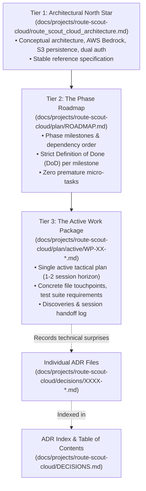
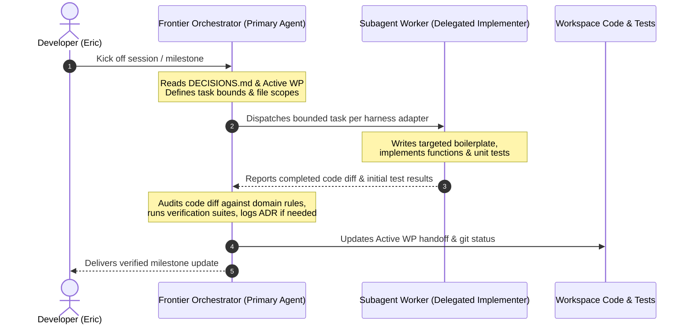

# Route Scout Cloud: Working Model & Multi-Session Execution Protocol

## 1. Motivation: Eliminating Agent Drift & Optimizing Quota

Large architectural initiatives that span multiple sessions typically fail when plans are kept as monolithic static checklists in markdown files. Over time:
1. **Unforeseen discoveries** in early steps cause tactical divergences, while future steps remain frozen in obsolete assumptions.
2. **Agent amnesia** between sessions leads incoming models to guess or undo deliberate compromises made by prior sessions.
3. **Context window bloat** from reading massive multi-phase plans leads agents to prematurely over-engineer for Step 8 instead of finishing and verifying Step 2.
4. **API quota exhaustion** occurs when high-tier frontier models spend their limited context and request allotments writing routine boilerplate or boilerplate tests.

This document defines the working model, planning structure, decision-recording engine, and orchestrator-worker delegation hierarchy for the **Route Scout Cloud Architecture** project.

---

## 2. The 3-Tier Rolling Wave Planning Model

Planning is partitioned into three distinct tiers of increasing granularity and freshness:

### Tier 1: The Architectural North Star
* **Location:** [`route_scout_cloud_architecture.md`](file:///home/eric/code/roadtrip-copilot/docs/projects/route-scout-cloud/route_scout_cloud_architecture.md)
* **Role:** The comprehensive system specification, data flows, AWS Bedrock ConverseStream design, S3 persistence, and dual-mode auth topology.
* **Update Frequency:** Rarely modified. Represents the long-term vision.

### Tier 2: The Phase Roadmap
* **Location:** `docs/projects/route-scout-cloud/plan/ROADMAP.md` *(authored when implementation begins)*
* **Role:** High-level milestones (e.g. M1: Dual-Mode Auth, M2: S3 Storage, M3: Bedrock Adapter, M4: Scout Grounding Tools, M5: AWS Container Deployment).
* **Rule:** Defines strict **Definition of Done (DoD)** and acceptance criteria for each milestone, but **strictly forbids premature micro-tasks for future milestones**. Milestone $N+1$ is never broken down into micro-tasks until Milestone $N$ is merged and verified.

### Tier 3: The Active Work Package
* **Location:** `docs/projects/route-scout-cloud/plan/active/WP-XX-<title>.md`
* **Role:** A just-in-time, concrete work order covering 1 to 2 sessions of active coding. Only **ONE** active work package file exists at any time.
* **Required Sections:**
  1. **Objective & Explicit Non-Goals:** What will be built, and what is explicitly out of scope for this package.
  2. **Affected Files & Interfaces:** File touchpoints and TypeScript contracts.
  3. **Step-by-Step Tactical Steps:** Focused sequential checklist.
  4. **Verification Plan:** Concrete commands that must pass (e.g. `npm run test:backend`, `npm test`).
  5. **Discoveries & Deviations Log:** The primary anti-drift mechanism. When a surprise is discovered, the agent logs what was learned and what was adjusted *before* continuing code edits.
  6. **Next Session Handoff:** Clear status notes on where execution stopped and the exact next step.

---

## 3. Architecture Decision Records (ADRs) & Index

When technical realities force a divergence from the original design (e.g. SDK constraints, API quotas, library quirks), we do not hide decisions in commit messages or leave conflicting code.

1. **Table of Contents Index ([`DECISIONS.md`](file:///home/eric/code/roadtrip-copilot/docs/projects/route-scout-cloud/DECISIONS.md)):**
   * A single, compact markdown file containing a scannable table of all decisions: ID, Date, Title, Status, 1-line Summary, and link to details.
   * Incoming agents read this small file first to rapidly build mental context on architectural choices.
2. **Individual ADR Files ([`decisions/`](file:///home/eric/code/roadtrip-copilot/docs/projects/route-scout-cloud/decisions/)):**
   * Standalone files created from [`0000-template.md`](file:///home/eric/code/roadtrip-copilot/docs/projects/route-scout-cloud/decisions/0000-template.md) (e.g. `0001-amazon-bedrock-single-bill-ai.md`).
   * Documents Context, Decision Drivers, Considered Options, Outcome, Consequences, and Code Touchpoints.
3. **Continuous Living Documentation (Zero Stale Non-Project Docs):**
   * Top-level and subproject documentation—specifically [`AGENTS.md`](file:///home/eric/code/roadtrip-copilot/AGENTS.md), [`README.md`](file:///home/eric/code/roadtrip-copilot/README.md), [`route-builder/AGENTS.md`](file:///home/eric/code/roadtrip-copilot/route-builder/AGENTS.md), [`route-builder/README.md`](file:///home/eric/code/roadtrip-copilot/route-builder/README.md), and [`docs/README.md`](file:///home/eric/code/roadtrip-copilot/docs/README.md)—**must never be left stale until the end of the project**.
   * Every Work Package must update these living documents **in the same milestone** whenever directory layouts, CLI scripts, environment variables, architectural pillars, or test suites change.

---

## 4. The Orchestrator-Worker Delegation Model (Quota Optimization)

To protect the user's high-tier frontier model quota and ensure high-level architectural coherence, all multi-agent work follows a strict **Orchestrator-Worker** division of labor:

### The Frontier Orchestrator (Primary Agent)
* **Models:** Frontier reasoning models.
* **Responsibilities:**
  * Authoring and refining Tier 2 (`ROADMAP.md`) and Tier 3 (`WP-XX.md`) planning files.
  * Researching external API contracts (AWS Bedrock, Google OIDC, Google Places New).
  * Defining TypeScript interfaces, boundary contracts, and architectural guardrails.
  * Formulating targeted prompts for subagents.
  * Reviewing subagent diffs, catching regressions, enforcing project rules from [`AGENTS.md`](file:///home/eric/code/roadtrip-copilot/AGENTS.md).
  * Running final verification test suites and writing handoff notes.

### Subagent Workers (Delegated Implementers)
* **Model & Harness Delegation:** Delegated per the active harness adapter (Antigravity: [`.agents/rules/antigravity-harness.md`](file:///home/eric/code/roadtrip-copilot/.agents/rules/antigravity-harness.md); OpenCode: [`.opencode/rules/harness.md`](file:///home/eric/code/roadtrip-copilot/.opencode/rules/harness.md)). Bound to cost-effective worker models / configured worker profiles to optimize developer quota.
* **Responsibilities:**
  * Implementing concrete functions, endpoints, or utility classes specified by the orchestrator.
  * Writing unit tests against mock fixtures.
  * Performing mechanical refactors, type annotations, and schema formatting.
  * Executing repetitive file edits.
* **Invocation Rule:** The orchestrator must provide worker subagents with **explicit, constrained tasks** (e.g., *"Implement the Google OIDC token verification helper in `server/services/authService.ts` matching interface X and write unit tests in `tests/authService.test.ts`"*). Avoid open-ended, ambiguous requests to worker subagents.

### Two-Gate Quality Protocol (Preventing Review Churn)
Earlier milestones suffered from multi-round PR review cycles when worker subagents were given underspecified prompts or when the orchestrator relied solely on happy-path test runs. The orchestrator is strictly accountable for first-pass PR quality through two mandatory gates:

#### Gate 1: Contract-First Work Package & Worker Prompts (Pre-Delegation)
Before dispatching any `flash` worker, the Orchestrator must verify live external dependencies (e.g., read-only AWS CLI checks against the project's assigned Region) and include the following in both the active Work Package (`WP-XX`) and the worker's prompt:
1. **Exact TypeScript Interfaces & Route Schemas:** Literal type signatures, request/response shapes, and explicit HTTP status codes (`200`, `400`, `401`, `403`, `404`, `412`, `500`, `503`). Never leave error status codes or fallback precedence to worker guesswork.
2. **Concurrency, Lifecycle & Resource Cleanup Invariants:**
   * **Frontend Async Flows:** Specify `AbortController` and/or monotonic request revision counters whenever React state is updated after an `await` (switching scopes, switching models, retrying, or closing modals must never allow a late-resolving response to overwrite newer state).
   * **Backend Streams & Timers:** Specify deterministic cleanup (`clearInterval`, abort signals) in both `finally` blocks and `reply.raw.on('close')` handlers. Bound all agentic/tool loops with a hard iteration cap (e.g., `MAX_TOOL_ITERATIONS`).
3. **AWS Region & Environment Resolution Rules:**
   * **Never hardcode `'us-east-1'`** as a fallback in regional AWS SDK clients (`S3Client`, `SSMClient`, `BedrockRuntimeClient`). Pass `region` only when explicitly provided or configured (`new Client(region ? { region } : {})`) so the AWS SDK resolves `~/.aws/config` / ambient credentials cleanly.
   * **Test Environment Isolation:** Snapshot and restore `process.env` in `beforeEach`/`afterEach` so tests never leak env state across cases.
4. **Security & Boundary Validation:**
   * Validate all caller-supplied identifiers (e.g., `modelId` against the configured catalog/allowlist, returning `400 Bad Request` for unknown values) at the route boundary before invoking cloud SDKs.
5. **UI Geometry & Browser Test Compatibility:**
   * Check how new UI controls and mount-time `fetch` calls interact with existing UI harnesses (`tests/ui/harness.tsx`) and Playwright browser tests (`tests/browser/appHeader.browser.ts`, which enforces single-row `56px` header height across `1024px–1920px` viewports and fails on any unmocked `/api/*` request).
6. **Zero Silent Fallbacks or Mock Degradation:**
   * Never instruct workers to build silent fallbacks to mock templates, client-side mocks, or local CLIs (`agy`). External API failures must fail loudly and transparently with explicit HTTP status codes (`502`, `503`, `400`). Building any fallback mechanism requires prior user consultation and explicit written approval.

#### Gate 2: Orchestrator Adversarial Diff Audit (Gate 2A) & Independent Review (Gate 2B)

##### Gate 2A: Orchestrator Personal Diff Audit & Multi-Suite Verification (Mandatory, Never Delegated)
A worker's self-reported success is never sufficient. Before opening or updating a PR, the Orchestrator must personally inspect the full `git diff` against this 8-point **Adversarial Review Checklist**:
1. **Region & IAM Accuracy:** Zero hardcoded `'us-east-1'` fallbacks in regional SDK clients; CDK IAM policies include all required resource ARNs (e.g., both `foundation-model/*` and `inference-profile/*` for Bedrock).
2. **Race Condition & Stale-State Audit:** Every async UI handler/effect guards post-`await` state mutations against `signal.aborted` or a revision ref; switching scope/model/trip mid-flight is race-safe.
3. **Timer, Listener & Stream Leak Audit:** Every `setInterval` (such as SSE keep-alives) and request timeout/abort listener is cleared in `finally` and on socket `close`.
4. **Boundary Validation & Error Status Fidelity:** Invalid parameters return `400` (not `500` or silent fallback); `ApiError` preserves HTTP status codes end-to-end.
5. **Zero Silent Fallbacks or Mock Degradation:** Catch blocks must never swallow errors to silently return canned mock responses, estimated fallback timings, or local-only tooling (`agy`). External service failures must bubble up cleanly with accurate status codes and user-visible error details.
6. **Prompt & Output Hygiene:** Internal model reasoning (`reasoningContent`, `<think>...</think>`, `<thinking>...</thinking>`) and SSE heartbeat comments (`: ping`, `: keep-alive`) never leak into user-visible text or corrupt JSON extraction.
7. **Adversarial Test Coverage:** Tests explicitly exercise unhappy paths—unknown `modelId` (`400`), stream error/disconnect timer cleanup, tool-loop iteration limit (`MAX_TOOL_ITERATIONS`), stale async response suppression, and failure propagation without silent mock degradation.
8. **Full Verification Matrix:** Both `./scripts/ci_check.sh` AND `cd route-builder && npm run test:browser` pass with zero warnings or layout regressions.

##### Gate 2B: Fresh-Context Read-Only Independent Review (Optional Supplement)
Independent subagent review supplements—and never replaces—the orchestrator's personal Gate 2A audit. Whereas **implementation workers** receive detailed Contract-First prompts (Gate 1), **independent reviewers** must remain unprimed so they can surface blind spots rather than merely checking off a predetermined list:
* **Short Neutral Prompt Only:** Provide only (1) the git diff/base revision to inspect, (2) pointers to the objective/spec (`WP-XX`) and architectural rules (`AGENTS.md`, `DECISIONS.md`), and (3) a unique `tmp/` findings file path for incremental output.
* **No Priming:** Do **not** supply a prior fix list, earlier review findings, or a targeted checklist of expected bugs in the review prompt. Never claim a review is "independent" if the reviewer was primed with prior findings.
* **Read-Only & Single-Level Boundaries:** Use a read-only reviewer configuration (`research` / `diff-reviewer`), writing only to the designated `tmp/` report path if requested, with no subagent nesting.

---

## 5. Agent Session Protocol

Every agent working on the Route Scout Cloud project must adhere to this three-phase session lifecycle:

### Phase A: Session Kickoff
1. Read [`DECISIONS.md`](file:///home/eric/code/roadtrip-copilot/docs/projects/route-scout-cloud/DECISIONS.md) to understand current technical precedents.
2. Read the active Work Package in `docs/projects/route-scout-cloud/plan/active/` to understand current progress and read the previous agent's handoff notes.
   * **Bootstrap / Milestone Transition Rule:** On Session 1 (or between milestones when `plan/active/` has no `WP-XX-*.md` file), the Orchestrator's first action—before any code modification—is to author `plan/ROADMAP.md` (if not yet created) and draft the next `plan/active/WP-XX-<slug>.md` with full Gate 1 Contract-First specifications.
3. Verify external cloud/API assumptions with read-only checks before delegating code changes, and state the active task scope to the user.

### Phase B: Execution & In-Flight Discoveries
1. Orchestrator defines exact interfaces, edge-case invariants, tests, and boundaries in the Work Package; delegates bounded implementation tasks to subagent workers per the active harness adapter using Gate 1 prompts.
2. **If an unexpected technical constraint is discovered:**
   * Stop immediately before writing speculative workarounds.
   * Record the decision in a new ADR file in [`decisions/`](file:///home/eric/code/roadtrip-copilot/docs/projects/route-scout-cloud/decisions/) and link it in [`DECISIONS.md`](file:///home/eric/code/roadtrip-copilot/docs/projects/route-scout-cloud/DECISIONS.md).
   * Update the "Discoveries & Deviations" section in the active Work Package.
3. Preserve all non-negotiable architectural rules from [`AGENTS.md`](file:///home/eric/code/roadtrip-copilot/AGENTS.md) and [`DECISIONS.md`](file:///home/eric/code/roadtrip-copilot/docs/projects/route-scout-cloud/DECISIONS.md) (e.g., zero cloud dependencies in `app/` drive loop, isolated local disk storage in `npm run dev` alongside Bedrock AI per ADR-0004, single assigned AWS project Region compliance, literal semicolons in OSRM paths, strict TypeScript with zero `any` types).

### Phase C: Session Wrap-Up, Adversarial Audit, Living Docs Sync & Verification
1. Perform the **Gate 2 Orchestrator Adversarial Diff Audit** across the entire `git diff`, fixing any concurrency, validation, cleanup, or test-coverage gaps before running final suites.
2. Run all verification and synthesis suites:
   * `./scripts/ci_check.sh` (Route Builder unit/integration tests + production build, CDK unit tests + `cdk synth`, Android unit tests).
   * `cd route-builder && npm run test:browser` (Playwright multi-viewport layout, header geometry, and API fixture verification).
3. **Sync Non-Project Living Documentation:** Verify and update [`AGENTS.md`](file:///home/eric/code/roadtrip-copilot/AGENTS.md), [`README.md`](file:///home/eric/code/roadtrip-copilot/README.md), [`route-builder/AGENTS.md`](file:///home/eric/code/roadtrip-copilot/route-builder/AGENTS.md), [`route-builder/README.md`](file:///home/eric/code/roadtrip-copilot/route-builder/README.md), [`docs/reference/directory-layout.md`](file:///home/eric/code/roadtrip-copilot/docs/reference/directory-layout.md), and [`docs/README.md`](file:///home/eric/code/roadtrip-copilot/docs/README.md) so directory trees, setup instructions, architecture sections, and command references accurately reflect the current codebase state.
4. Update the active Work Package:
   * Check off completed tactical steps.
   * Write explicit "Where We Stopped" and "Next Step" notes in the Next Session Handoff section.
5. If the entire Work Package Definition of Done (including live AWS deployment when authorized by the user, manual verification, and living documentation sync) is satisfied:
   * Move the work package from `docs/projects/route-scout-cloud/plan/active/` to `docs/projects/route-scout-cloud/plan/archive/`.
   * Update the milestone status in `docs/projects/route-scout-cloud/plan/ROADMAP.md`.
