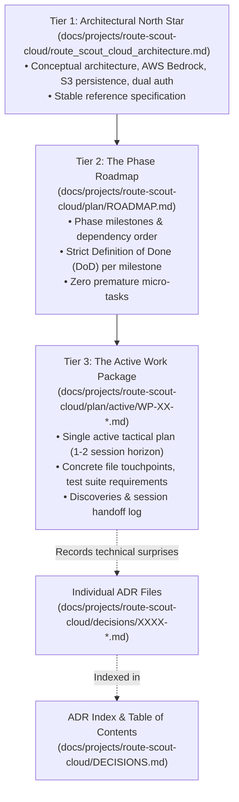
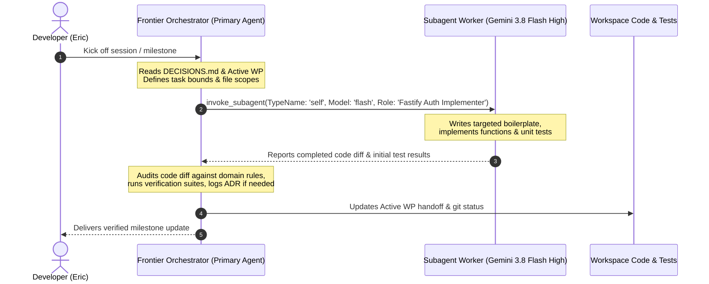

# Route Scout Cloud: Working Model & Multi-Session Execution Protocol

## 1. Motivation: Eliminating Agent Drift & Optimizing Quota

Large architectural initiatives that span multiple sessions typically fail when plans are kept as monolithic static checklists in markdown files. Over time:
1. **Unforeseen discoveries** in early steps cause tactical divergences, while future steps remain frozen in obsolete assumptions.
2. **Agent amnesia** between sessions leads incoming models to guess or undo deliberate compromises made by prior sessions.
3. **Context window bloat** from reading massive multi-phase plans leads agents to prematurely over-engineer for Step 8 instead of finishing and verifying Step 2.
4. **API quota exhaustion** occurs when high-tier frontier models spend their limited context and request allotments writing routine boilerplate or boilerplate tests.

This document defines the working model, planning structure, decision-recording engine, and orchestrator-worker delegation hierarchy for the **Route Scout Cloud Architecture** project.

---

## 2. The 3-Tier Rolling Wave Planning Model

Planning is partitioned into three distinct tiers of increasing granularity and freshness:

### Tier 1: The Architectural North Star
* **Location:** [`route_scout_cloud_architecture.md`](file:///home/eric/code/roadtrip-copilot/docs/projects/route-scout-cloud/route_scout_cloud_architecture.md)
* **Role:** The comprehensive system specification, data flows, AWS Bedrock ConverseStream design, S3 persistence, and dual-mode auth topology.
* **Update Frequency:** Rarely modified. Represents the long-term vision.

### Tier 2: The Phase Roadmap
* **Location:** `docs/projects/route-scout-cloud/plan/ROADMAP.md` *(authored when implementation begins)*
* **Role:** High-level milestones (e.g. M1: Dual-Mode Auth, M2: S3 Storage, M3: Bedrock Adapter, M4: Scout Grounding Tools, M5: AWS Container Deployment).
* **Rule:** Defines strict **Definition of Done (DoD)** and acceptance criteria for each milestone, but **strictly forbids premature micro-tasks for future milestones**. Milestone $N+1$ is never broken down into micro-tasks until Milestone $N$ is merged and verified.

### Tier 3: The Active Work Package
* **Location:** `docs/projects/route-scout-cloud/plan/active/WP-XX-<title>.md`
* **Role:** A just-in-time, concrete work order covering 1 to 2 sessions of active coding. Only **ONE** active work package file exists at any time.
* **Required Sections:**
  1. **Objective & Explicit Non-Goals:** What will be built, and what is explicitly out of scope for this package.
  2. **Affected Files & Interfaces:** File touchpoints and TypeScript contracts.
  3. **Step-by-Step Tactical Steps:** Focused sequential checklist.
  4. **Verification Plan:** Concrete commands that must pass (e.g. `npm run test:backend`, `npm test`).
  5. **Discoveries & Deviations Log:** The primary anti-drift mechanism. When a surprise is discovered, the agent logs what was learned and what was adjusted *before* continuing code edits.
  6. **Next Session Handoff:** Clear status notes on where execution stopped and the exact next step.

---

## 3. Architecture Decision Records (ADRs) & Index

When technical realities force a divergence from the original design (e.g. SDK constraints, API quotas, library quirks), we do not hide decisions in commit messages or leave conflicting code.

1. **Table of Contents Index ([`DECISIONS.md`](file:///home/eric/code/roadtrip-copilot/docs/projects/route-scout-cloud/DECISIONS.md)):**
   * A single, compact markdown file containing a scannable table of all decisions: ID, Date, Title, Status, 1-line Summary, and link to details.
   * Incoming agents read this small file first to rapidly build mental context on architectural choices.
2. **Individual ADR Files ([`decisions/`](file:///home/eric/code/roadtrip-copilot/docs/projects/route-scout-cloud/decisions/)):**
   * Standalone files created from [`0000-template.md`](file:///home/eric/code/roadtrip-copilot/docs/projects/route-scout-cloud/decisions/0000-template.md) (e.g. `0001-amazon-bedrock-single-bill-ai.md`).
   * Documents Context, Decision Drivers, Considered Options, Outcome, Consequences, and Code Touchpoints.
3. **End-of-Project Hoisting & Compression:**
   * At the completion of the Route Scout Cloud project, decisions of permanent cross-project significance will be compressed and hoisted to [`docs/reference/`](file:///home/eric/code/roadtrip-copilot/docs/reference/) and [`AGENTS.md`](file:///home/eric/code/roadtrip-copilot/AGENTS.md), while project-local ephemeral decisions remain archived here.

---

## 4. The Orchestrator-Worker Delegation Model (Quota Optimization)

To protect the user's high-tier frontier model quota and ensure high-level architectural coherence, all multi-agent work follows a strict **Orchestrator-Worker** division of labor:

### The Frontier Orchestrator (Primary Agent)
* **Models:** Frontier reasoning models.
* **Responsibilities:**
  * Authoring and refining Tier 2 (`ROADMAP.md`) and Tier 3 (`WP-XX.md`) planning files.
  * Researching external API contracts (AWS Bedrock, Google OIDC, Google Places New).
  * Defining TypeScript interfaces, boundary contracts, and architectural guardrails.
  * Formulating targeted prompts for subagents.
  * Reviewing subagent diffs, catching regressions, enforcing project rules from [`AGENTS.md`](file:///home/eric/code/roadtrip-copilot/AGENTS.md).
  * Running final verification test suites and writing handoff notes.

### Subagent Workers (Delegated Implementers)
* **Model & Type:** Invoke with `TypeName: 'self'` and `Model: 'flash'` (**Gemini 3.8 Flash High**) via `invoke_subagent` (`TypeName: 'self'` is required so the worker has file-edit and command execution tools; use `TypeName: 'research'` with `Model: 'flash'` only for read-only lookups).
* **Responsibilities:**
  * Implementing concrete functions, endpoints, or utility classes specified by the orchestrator.
  * Writing unit tests against mock fixtures.
  * Performing mechanical refactors, type annotations, and schema formatting.
  * Executing repetitive file edits.
* **Invocation Rule:** The orchestrator must provide worker subagents with **explicit, constrained tasks** (e.g., *"Implement the Google OIDC token verification helper in `server/services/authService.ts` matching interface X and write unit tests in `tests/authService.test.ts`"*). Avoid open-ended, ambiguous requests to worker subagents.

---

## 5. Agent Session Protocol

Every agent working on the Route Scout Cloud project must adhere to this three-phase session lifecycle:

### Phase A: Session Kickoff
1. Read [`DECISIONS.md`](file:///home/eric/code/roadtrip-copilot/docs/projects/route-scout-cloud/DECISIONS.md) to understand current technical precedents.
2. Read the active Work Package in `docs/projects/route-scout-cloud/plan/active/` to understand current progress and read the previous agent's handoff notes.
   * **Bootstrap / Milestone Transition Rule:** On Session 1 (or between milestones when `plan/active/` has no `WP-XX-*.md` file), the Orchestrator's first action—before any code modification—is to author `plan/ROADMAP.md` (if not yet created) and draft the next `plan/active/WP-XX-<slug>.md` for user alignment.
3. Explicitly state the active task scope and planned actions to the user before editing code.

### Phase B: Execution & In-Flight Discoveries
1. Orchestrator defines interfaces, tests, and boundaries; delegates routine implementation to subagent workers (`TypeName: 'self'`, `Model: 'flash'`).
2. **If an unexpected technical constraint is discovered:**
   * Stop immediately before writing speculative workarounds.
   * Record the decision in a new ADR file in [`decisions/`](file:///home/eric/code/roadtrip-copilot/docs/projects/route-scout-cloud/decisions/) and link it in [`DECISIONS.md`](file:///home/eric/code/roadtrip-copilot/docs/projects/route-scout-cloud/DECISIONS.md).
   * Update the "Discoveries & Deviations" section in the active Work Package.
3. Preserve all non-negotiable architectural rules from [`AGENTS.md`](file:///home/eric/code/roadtrip-copilot/AGENTS.md) (e.g., zero cloud dependencies in `app/` drive loop, literal semicolons in OSRM paths, strict TypeScript with zero `any` types).

### Phase C: Session Wrap-Up & Verification
1. Run all relevant test suites (e.g. `npm test`, `npm run test:backend`).
2. Update the active Work Package:
   * Check off completed tactical steps.
   * Write explicit "Where We Stopped" and "Next Step" notes in the Next Session Handoff section.
3. If the entire Work Package Definition of Done is satisfied:
   * Move the work package from `docs/projects/route-scout-cloud/plan/active/` to `docs/projects/route-scout-cloud/plan/archive/`.
   * Update the milestone status in `docs/projects/route-scout-cloud/plan/ROADMAP.md`.
