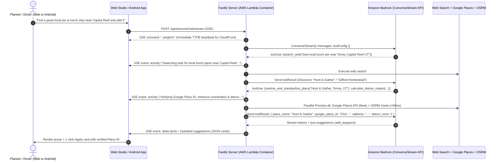
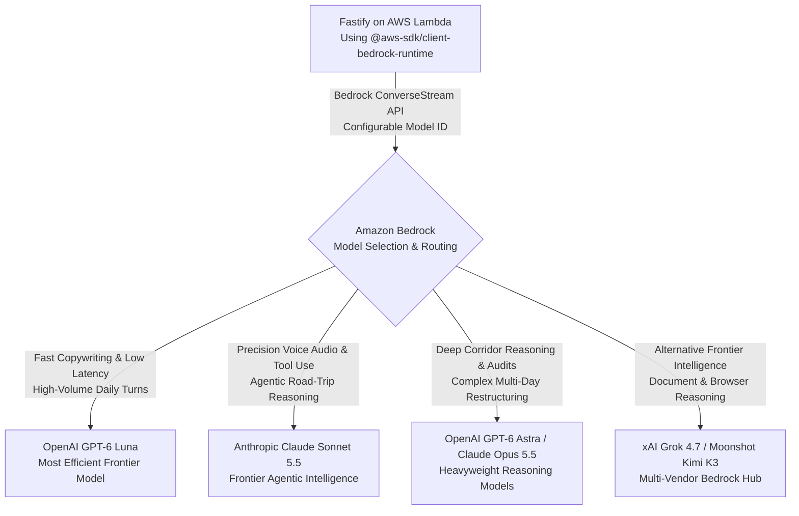
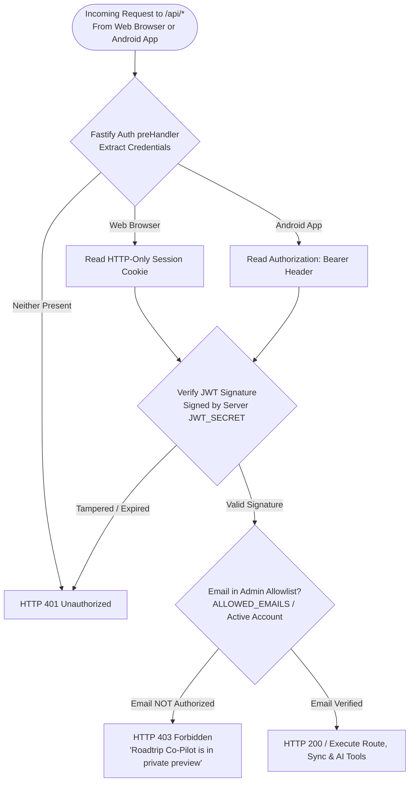
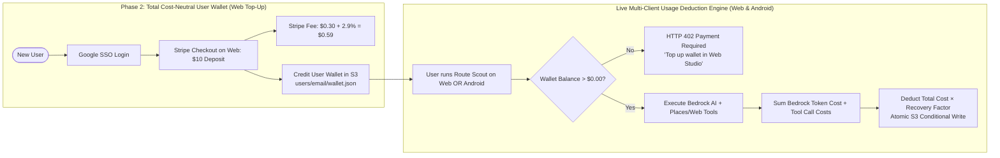

# Cloud Architecture Blueprint: Next-Generation Route Studio, Auth, Billing & AWS Deployment

This document defines the production cloud architecture for **Roadtrip Co-Pilot**. It evaluates the platform's transition from local CLI tooling (`agy`) to an ultra-fast, multi-provider cloud architecture hosted entirely on **Amazon Web Services (AWS)**—including **Amazon Bedrock** for single-bill AI routing, **Amazon S3** for zero-maintenance persistence, **zero-trust dual-mode authentication** (serving both the Web Studio and the Android app), **total-cost-recovery billing**, and **zero-idle-cost cloud deployment**.

---

## 1. Executive Summary: What the App Has Become

When early cloud research was conducted, Route Scout was an experimental prototype and the Route Builder was in its infancy. Today, Roadtrip Co-Pilot has matured into a multi-platform ecosystem with a **Cloud Backend on AWS** serving two clients—the **Route Builder Web Studio** and the **Android Co-Pilot App**—while keeping the **In-Car Drive Loop 100% offline-capable**:

```mermaid
flowchart LR
    subgraph Clients["Multi-Platform Clients"]
        Studio["Route Builder Web Studio\n(React SPA on S3 + CloudFront)"]
        AndroidOnline["Android App: Online Mode\n(On-the-Fly Route Scout & Cloud Sync)"]
    end

    subgraph CloudHosted["Cloud-Hosted Backend on AWS (Fastify on Lambda + S3 + Bedrock)"]
        AuthGate["Zero-Trust Dual-Mode Auth Gate\n(Google OIDC · Web Cookies & Mobile Bearer JWT)"]
        Scout["Route Scout Conversational Co-Pilot\n(Day Scope & Waypoint Scope)"]
        Copywriter["Copilot Alert & Audio Copywriter\n(Single & Batch Generation)"]
        BackendTools["Discovery & Domain Grounding Tools\n(Web Search, Google Places, OSRM, Cascade)"]
        AIRouter["AWS AI Engine: Amazon Bedrock\n(ConverseStream · Configurable Frontier Models)"]
        S3Store["Amazon S3 Persistence Layer\n(User Itineraries & Prepaid Wallet Ledgers)"]
        BillingEngine["Token & Tool Metering Engine\n(Prepaid Usage Credit Pool + Fee Recovery)"]
    end

    subgraph OfflineCar["Android App: In-Car Runtime (100% Offline-Capable & Free)"]
        LocalEdit["Tier 1 Local Route Editor\n(Offline Delete/Skip/Dwell, Cascade & Maps URL)"]
        Service["Android Foreground Service\n(LocationTracker, AudioDuckEngine)"]
        AutoUI["Android Auto Coolwalk UI\n(MessagingStyle Heads-Up Cards)"]
        PaceEngine["Pace & Schedule Telemetry Engine\n(Ahead/Behind Schedule)"]
    end

    Studio --> AuthGate
    AndroidOnline --> AuthGate
    AuthGate --> Scout
    AuthGate --> Copywriter
    AuthGate --> S3Store
    Scout --> BackendTools
    Scout --> AIRouter
    Copywriter --> AIRouter
    AIRouter --> BillingEngine
    BackendTools --> BillingEngine
    BillingEngine --> S3Store
    S3Store <-->|2-Way Cloud Sync / QR / SAF| LocalEdit
    LocalEdit --> Service
    Service --> AutoUI
    Service --> PaceEngine
```



### The Architectural Divide: Offline-First Core, Cloud-Enhanced Authoring
1. **The In-Car Drive Loop (`app/`) Remains 100% Offline-Capable:**
   * Operates under **Rule 1**: *Never add cloud API dependencies to the Android in-car drive loop*. In national parks, mountain passes, and desert corridors, cellular connectivity drops to zero. Android Auto heads-up cards, audio ducking, GNSS location tracking, schedule telemetry, and Tier 1 on-the-fly route adjustments (deleting or skipping a stop, adjusting dwell time, and regenerating Google Maps links) run entirely on-device without internet access.
2. **The Cloud Backend (`route-builder/server/`) Moves to AWS & Serves Both Web and Android:**
   * **Web Client:** Planners design, edit, and audit multi-day road trips via desktop browsers, tablets, or mobile web without installing Node.js, Python, or the Antigravity CLI (`agy`).
   * **Android Client (When Online):** When cellular or Wi-Fi connectivity is available, the Android app acts as a second native client to the same Fastify cloud API—enabling 2-way cloud itinerary sync from S3 and on-the-fly conversational Route Scout queries from the passenger seat, rest stop, or hotel. (See [android_route_editing_and_cloud_client.md](../android-route-client/android_route_editing_and_cloud_client.md) for the dedicated Android client specification.)

### Advanced Domain Capabilities Acquired by the App
The modern cloud AI system natively understands and honors core road-trip domain constraints:
* **Anticipatory TTS Voice Scripts:** 15–25 word conversational speech scripts strictly written in *anticipatory future tense* ("Approaching...", "Coming up ahead in half a mile..."), never present or past tense.
* **In-Transit Scenic Notification Triggers vs Physical Stops:** In-transit cues (`dwell = 0m`, `scenic_drive_by`) must lie *directly on the highway centerline* without taking the driver off-ramp. Physical stops (meals, fuel, lodging) must have verified parking entrances and authentic street addresses.
* **Route-Forcing Anchors (`is_route_anchor`):** Strategic pass-through waypoints that steer Google Maps along scenic corridors (e.g. AZ-179, Route 66) rather than interstate bypasses, while avoiding divided highway roundabout U-turn hazards.
* **Clean Place Decoupling & Protobuf Place IDs:** Decouples human-facing display names (`name`) from clean navigation queries (`place_name`) and enforces binary protobuf validation (`isValidGooglePlaceId`) on Google Place IDs.
* **Commercial Brand Verification for Fuel Stops:** Validates recognized service station brands (Maverik, Love's, Pilot) with restrooms and traveler amenities, rejecting coordinates in residential zones.
* **Full Lifecycle Suggestion Actions (`add_waypoint`, `update_waypoint`, `delete_waypoint`):** Route Scout emits structured `json:suggestions` cards supporting adding new stops, updating existing stops, or deleting stops when schedules tighten.
* **Cascade Schedule Ripple Math:** Downstream arrival/departure cascade, cross-state timezone boundary detection, and backward scheduling from destination deadlines ("Catch-up" mode).

---

## 2. The Tool Calling Reality: Web Discovery + Deterministic Domain Grounding

A common misconception in early AI design is assuming cloud models "run tools in the cloud." In modern frontier LLM architectures, **models do not execute tools—they only predict function names and JSON arguments.**

### The Two-Stage Tool Philosophy: Discovery vs. Grounding
Road-trip planning requires two fundamentally different kinds of intelligence, and the tool architecture must treat both as first-class citizens:

1. **Stage 1: Open-Ended Discovery & Road-Trip Intelligence (`search_web`, `read_url_content`):**
   * **Why Web Search Remains Essential:** You cannot ask a structured map or places database *"Where is the scenic pull-off on US-89A where the highway first climbs into the pines?"*, *"What are the best local non-chain lunch spots along this corridor?"*, *"Is Tioga Pass closed for snow?"*, or *"What is the geological history of this mesa for the spoken audio script?"*
   * Web search and URL reading are the primary discovery engines for scenic overlooks, hidden gems, local dining recommendations, highway milepost transitions, seasonal advisories, and storytelling context.
2. **Stage 2: Deterministic Grounding, Standardization & Schedule Math (Bespoke Domain Tools):**
   * Once Route Scout discovers a physical venue or scenic milestone (via `search_web` or user input), it should **never** waste turns running secondary web searches trying to scrape a Google Place ID, guess entrance coordinates, or do mental schedule math.
   * Instead, the model invokes fast, deterministic backend domain tools (`resolve_and_standardize_place`, `snap_to_highway_corridor`, `calculate_detour_impact`, `simulate_schedule_cascade`) that ground the discovery into verified coordinates, standardized `place_name` / `address` / `ChIJ...` Place IDs, and exact cascade timing in under 100ms.

### The Tool Execution Lifecycle
In standard function calling (AWS Bedrock Converse API, OpenAI spec, Anthropic spec), tool execution is a coordinated, turn-based loop where **your app's Fastify backend executes all tools**:



### Why Backend Tool Execution is a Massive Advantage
Having tools executed on the Fastify backend—rather than inside a generic CLI sandbox—gives Roadtrip Co-Pilot major advantages:

1. **Direct Access to App Road Graphs & Geometry:** No cloud model knows about the current route polyline, cached OSRM highway nodes, or waypoint sequences. The Fastify backend has instantaneous access to all of them in memory.
2. **Sub-100ms Deterministic Grounding:** In-memory OSRM queries, Haversine calculations, and Google Places API lookups execute in **15 to 90 milliseconds**, compared to 15,000–45,000 milliseconds for a CLI agent spawning bash scripts and scraping URLs.
3. **Parallel Tool Dispatch:** When a model asks to verify 4 candidate waypoints simultaneously, Fastify executes all 4 checks concurrently using `Promise.all`.
4. **Server-Side Suggestion Hydration Backstop:** Because Fastify executes `resolve_and_standardize_place` during the turn, Fastify caches the verified `google_place_id`, `place_name`, `address`, and `lat`/`lng`. When parsing the LLM's final `json:suggestions` output, Fastify deterministically validates and hydrates those exact fields—guaranteeing zero hallucinated Place IDs and zero malformed Google Maps links.
5. **Real-Time UI Activity Streaming:** As Fastify executes each tool, it immediately streams an SSE `activity` event to the client (`RouteScoutDrawer.tsx` or Android sheet), so the user sees live progress badges without delay.

### The 7 Core Fastify Tools (2 Discovery + 5 Domain Grounding)

| Category | Tool Name | Parameters | Backend Implementation | Output to Model |
| :--- | :--- | :--- | :--- | :--- |
| **Discovery** | **`search_web`** | `query: string` | Web Search API (e.g., Brave Search / Tavily API) | Ranked web snippets & URLs for discovering scenic overlooks, best local restaurants, road conditions, mile markers, and local history. |
| **Discovery** | **`read_url_content`** | `url: string` | Fast HTTP fetch + HTML-to-Markdown extractor | Clean article/page text from travel guides, NPS advisories, or venue pages. |
| **Grounding** | **`resolve_and_standardize_place`** | `query: string, lat?: number, lng?: number, radius_miles?: number` | **Google Places API (New)** (`places:searchText` with targeted `fieldMask`) + `isValidGooglePlaceId` | Authoritative `google_place_id` (`ChIJ...`), standardized clean `place_name` (decoupled from display `name`), verified street `address`, entrance `lat`/`lng`, and operating hours. |
| **Grounding** | **`snap_to_highway_corridor`** | `lat: number, lng: number, road_name?: string` | Queries OSRM `/nearest` (with Amazon Location Service fallback) | Exact coordinate on highway centerline, snapped distance (meters), road name. Guarantees `scenic_drive_by` triggers never leave the highway. |
| **Grounding** | **`calculate_detour_impact`** | `candidate_lat: number, candidate_lng: number, after_waypoint_id: string` | Runs OSRM `/route` comparing current leg vs leg with detour | Extra driving miles and minutes added to the itinerary. Enables Scout to warn: *"This stop adds 18 minutes of driving."* |
| **Grounding** | **`simulate_schedule_cascade`** | `action: 'add' \| 'update' \| 'delete', target_waypoint_id: string, dwell_minutes?: number` | Runs in-memory `cascade.ts` engine | Shifted arrival/departure times for all downstream stops, timezone boundary crossings, and sunset warnings. |
| **Grounding** | **`audit_corridor_waypoints`** | `day_number?: number` | Batch-checks all stops on active day against highway polyline, speed anomalies (<30 mph), and Place ID validity | Structured diagnostic report of off-highway drive-bys, missing physical addresses, or notification/category mismatches. |

### Google Places API (New) & Routing Cost Strategy
* **Phase 1 (Single User — $0.00/Month):**
  * You are already creating a Google Cloud Project for **Google OAuth SSO**. Enabling **Google Places API (New)** in that exact same project provides **5,000 to 10,000 free requests per month** under Google's permanent monthly free tier.
  * Using a strict HTTP header `X-Goog-FieldMask: places.id,places.displayName,places.formattedAddress,places.location,places.types,places.regularOpeningHours` restricts billing to the lowest tier SKU and avoids unnecessary payload data.
  * **Hard Quota Cap:** Configure a daily/monthly request quota cap in the Google Cloud Console strictly below the free-tier threshold so **it is impossible for Google Cloud to ever bill a single cent during Phase 1**.
* **Phase 2 (Multi-User Paid Wallets — 100% Cost Recovery):**
  * When paid user wallets are enabled, Fastify tracks the exact number of `resolve_and_standardize_place` and `search_web` calls executed during a turn and adds their exact per-call API cost (~$0.017 per Places lookup once past the free tier) to the Bedrock token deduction.
* **Routing Resilience (OSRM + Amazon Location Service Fallback):**
  * Public OSRM (`router.project-osrm.org`) remains the primary zero-cost routing engine. If shared AWS Lambda IPs ever encounter public OSRM rate-limiting, **Amazon Location Service Routes** (`@aws-sdk/client-location`, ~$0.0005 per request via IAM role on the single AWS bill) serves as a drop-in fallback.

---

## 3. The Single-Bill AI Solution: Amazon Bedrock & Configurable Model Selection

Can we solve the AI routing and model access requirements **entirely within AWS** so the platform's compute, storage, and AI inference live under **one single AWS bill**?

**Yes, completely.** **Amazon Bedrock** is AWS's fully managed multi-model service. It solves model diversity, function calling, streaming, and prompt routing while consolidating compute, hosting, and AI inference onto your monthly AWS invoice.



### Why Amazon Bedrock Fits This Project Perfectly
1. **Consolidated Monthly AWS Invoice:** S3 static assets and itinerary storage, CloudFront CDN egress, Lambda compute, and Bedrock AI tokens all appear on your single AWS bill.
2. **Zero AI API Keys & IAM Role Security:** You do not store AI API keys in `.env` files. The Lambda container assumes an **AWS IAM execution role** granting `bedrock:InvokeModelWithResponseStream`.
3. **The Unified Bedrock Converse API (`Converse` & `ConverseStream`):** AWS provides a single, uniform SDK and schema across all models on Bedrock (OpenAI, Anthropic, xAI, Moonshot). Switching from OpenAI GPT-6 Luna to Claude Sonnet 5.5 requires changing a single model ID string (`openai.gpt-6-luna` vs `anthropic.claude-sonnet-5-5`).
4. **Runtime Model Selection & Override:** Because all models share the `ConverseStream` contract, the Fastify backend supports **configurable model selection**:
   * **Environment Defaults:** Set default models via `BEDROCK_SCOUT_MODEL_ID` (e.g. `anthropic.claude-sonnet-5-5` or `openai.gpt-6-luna`) and `BEDROCK_COPYWRITER_MODEL_ID` (e.g. `openai.gpt-6-luna`).
   * **Per-Request / UI Selection:** Expose available models via `GET /api/ai/status` and allow the user to switch the active model in the Web Studio or Android app settings (e.g., choosing a fast, ultra-cheap model for quick turns vs. a heavyweight model for deep multi-day corridor restructuring).
5. **Native Tool Use (Function Calling) & Streaming:** Bedrock's `ConverseStream` API natively handles function declarations (`toolConfig`), emits tool invocation payloads, accepts tool results, and streams tokens over HTTP.
6. **Zero Idle Base Fee ($0.00/Month):** Bedrock on-demand pricing is billed strictly per token consumed. When idle, Bedrock costs **$0.00/month**.

> [!IMPORTANT]
> **Amazon Bedrock Multi-Vendor Frontier Catalog**  
> Bedrock is not limited to legacy models or locked into a single provider. In AWS, Amazon Bedrock hosts the latest frontier models across **OpenAI (GPT-6 series: GPT-6 Luna, GPT-6 Sol, GPT-6.1 Sol, GPT-6 Astra)**, **Anthropic (Claude Sonnet 5.5, Claude Opus 5.5)**, **xAI (Grok 4.7)**, and **Moonshot AI (Kimi K3)**. Future agents and developers must leverage these modern frontier models via Bedrock's standardized `ConverseStream` API under the single consolidated AWS invoice.

### Top Bedrock Models for Roadtrip Co-Pilot

| Model | Provider on Bedrock | Role in Roadtrip Co-Pilot | Key Capabilities |
| :--- | :--- | :--- | :--- |
| **OpenAI GPT-6 Luna** | OpenAI | **Primary Fast Engine & Copywriter** | The most efficient GPT-6 model for focused, high-volume tasks. Microscopic latency and token costs, ideal for real-time Route Scout chat and 1-click alert copywriting. |
| **Anthropic Claude Sonnet 5.5** | Anthropic | **Primary Co-Pilot & Stylist** | Clear leap forward on agentic tool use and negative constraints. Flawless execution of anticipatory future tense, highway centerline snapping, and JSON suggestion cards. |
| **OpenAI GPT-6 Sol / GPT-6.1 Sol** | OpenAI | **Standard Co-Pilot & Analysis** | Strong, repeatable performance tuned for scale, agentic workflows, and corridor logistics. |
| **OpenAI GPT-6 Astra** | OpenAI | **Deep Corridor Audit Engine** | The largest and most capable model from OpenAI to date, built for complex multi-day route restructuring and edge-case conflict resolution. |
| **Anthropic Claude Opus 5.5** | Anthropic | **Flagship Multi-Day Architect** | Anthropic's most capable Opus model, handling long-running itineraries, timezone cascades, and multi-leg route auditing. |
| **xAI Grok 4.7** | xAI | **Alternative Agentic Engine** | Frontier model built for long-horizon agentic workflows, live data verification, and tool dispatch. |
| **Moonshot Kimi K3** | Moonshot AI | **Long-Context Corridor Engine** | 2.8-trillion-parameter MoE model with native vision and 1-million-token context window. |

### Architectural Flexibility: Adapter Seam Preserved
Because Fastify uses the `AiHarnessAdapter` pattern, the app maintains complete architectural freedom:
* **Primary Cloud Adapter:** `AwsBedrockHarnessAdapter` (using `@aws-sdk/client-bedrock-runtime` for single-bill AWS deployment).
* **Local / Alternative Adapters:** `AgyHarnessAdapter` / `GeminiStudioHarnessAdapter` / `OpenAiCompatibleHarnessAdapter` remain intact for local development or offline testing.

---

## 4. Authentication & Access Gating: Dual-Mode Zero-Trust (Web + Android)

Deploying the backend to the public internet with Bedrock AI inference attached to your AWS account requires immediate, airtight access gating. Furthermore, because **both the Web Studio and the Android App** will call `/api/*`, the authentication gate must cleanly support both browser sessions and native mobile clients.



### The Anti-Spoofing Guarantee: Cryptographically Signed IdP Claims
A critical security question is: *What email is this allowlist checked against, and could a malicious actor spoof that email?*

**No, spoofing is cryptographically impossible.** In both Web and Android flows, the email claim is acquired and verified strictly through Google's OpenID Connect (OIDC) protocol:

1. **Web Studio Flow (OAuth2 Redirect + `HTTP-Only` Cookie):**
   * Fastify redirects the browser to `accounts.google.com` with a one-time `state` token and PKCE challenge.
   * Google redirects back to `/api/auth/callback/google` with a single-use `authorization_code`.
   * Fastify performs a server-to-server backchannel exchange with Google (`oauth2.googleapis.com/token`), verifies Google's cryptographically signed `id_token`, checks `email_verified === true` and `ALLOWED_EMAILS`, and issues an `HTTP-Only`, `Secure`, `SameSite=Lax` JWT cookie signed with `JWT_SECRET`.
2. **Android Native Client Flow (Android Credential Manager + Bearer JWT):**
   * On Android, browser redirects are clunky. Instead, the Android app uses Google's official native **Credential Manager (`Sign in with Google`)** to obtain a Google-signed OIDC `id_token` directly from the OS.
   * The Android app sends that `id_token` to `POST /api/auth/mobile/google`.
   * Fastify verifies the `id_token` signature against Google's public JWKS keys, confirms the email is in `ALLOWED_EMAILS`, and returns a signed session JWT that the Android app stores in `EncryptedSharedPreferences` and passes via `Authorization: Bearer <token>`.

### Why Stateless Dual-Mode JWT is the Ideal Fit
* **100% Free Forever:** Zero third-party SaaS auth subscriptions (no Clerk, no Auth0, no Cognito MAU tiers).
* **Zero Database Overhead:** Fastify validates either the Web Cookie or the Android Bearer header in under 1ms using `@fastify/jwt` and `@fastify/cookie`.

---

## 5. Payment Architecture: Total Cost Recovery & Multi-Client Wallet

While payment is deferred during Phase 1 (when Eric is the sole authorized user), the architecture guarantees **Total Cost Neutrality** before opening the app to other users in Phase 2.

### The Total Cost Neutrality Principle
This system is not about high-margin SaaS subscriptions. The non-negotiable rule is: **Eric must never spend a single cent of his own money for other people to use his app.**

To achieve true cost neutrality, user payments must cover **all four operational cost pillars**:
1. **AI Token Spend:** AWS Bedrock inference charges (input + output tokens).
2. **External Tool Call Spend:** Per-call costs for Google Places API (`resolve_and_standardize_place`) and Web Search (`search_web`) once past monthly free tiers.
3. **Payment Processing Fees:** Stripe transaction fees ($0.30 + 2.9%).
4. **Cloud Infrastructure Overhead:** AWS Lambda compute, S3 storage/requests, and CloudFront data egress.



### Why the Prepaid Credit Wallet is the Only Safe Pattern
Under the **Prepaid Credit Wallet pattern**:
* Users deposit $5.00 or $10.00 upfront via Stripe Checkout.
* Funds are captured before a single AI token or paid Places lookup is executed.
* When the user's credit balance reaches $0.00, AI features immediately lock (`HTTP 402`) across both the Web Studio and the Android app until they top up.
* **Zero Financial Risk:** It is mathematically impossible for a user to incur debt on Eric's credit card.

### Covering Stripe, Tool & Infrastructure Fees
When a user pays via Stripe, Stripe charges **2.9% + $0.30** per transaction ($0.59 on a $10.00 deposit).

> [!NOTE]
> **Owner Preference & Trade-off Consideration:**  
> Eric prefers **Option B (Recovery Markup Factor)** for its simplicity to the end user (depositing $10 shows an even $10 balance), while noting the cash-flow nuance that if a user deposits $10 and never uses AI, Stripe collects the $0.59 fee immediately. Both options remain supported by the ledger formula:

* **Option A (Net Balance Crediting — Zero Owner Float):**
  * User deposits $10.00 $\to$ Wallet credited with net proceeds (**$9.41**).
  * Turns deduct exact raw Bedrock token cost + exact tool call cost.
* **Option B (Recovery Markup Factor — User Preferred):**
  * User deposits $10.00 $\to$ Wallet credited with **$10.00**.
  * Each AI turn deducts:
    $$\text{Turn Deduction} = (\text{Bedrock Token Cost} + \text{Tool Call Cost}) \times 1.25$$
  * That $1.25\times$ recovery multiplier absorbs the Stripe fee and AWS Lambda/S3/CloudFront overhead automatically as credits are consumed.

### Multi-Client Wallet Consumption (Avoiding Play Store 30% Tax)
When the Android app uses Route Scout in Phase 2, how does billing work without triggering Google Play Store's 15–30% commission or requiring the Google Play Billing SDK?
* **Web Top-Up, Everywhere Consumption:** Users manage and top up their prepaid credit wallet via Stripe on the **Web Studio**.
* The Android app simply authenticates with the same Google account, displays their remaining credit capacity, and consumes their existing cloud wallet balance when making Route Scout calls (with zero links or buttons to external Stripe checkout inside the Android APK, complying with Google Play's multi-platform consumption rules).

---

## 6. Deployment & S3 Persistence Architecture on AWS ($0.00/Month Idle)

On AWS Lambda, container memory and `/tmp` disk are ephemeral—they disappear whenever the container scales to zero. To persist user itineraries and wallet balances with **simplicity, easy debugging, and near-zero cost**, the architecture uses **Amazon S3** as its unified persistence layer alongside static asset hosting.

```mermaid
flowchart TD
    WebUser([Web Browser]) --> CloudFront[AWS CloudFront CDN\n• Free SSL via ACM\n• 1 TB/mo Free Egress]
    AndroidApp([Android Co-Pilot App]) -->|HTTPS /api/*\nBearer JWT| CloudFront
    
    CloudFront -->|Path: /* (Static SPA)| S3Static[Amazon S3: Static Web Assets\n• route-builder/dist/]
    
    CloudFront -->|Path: /api/* (API & SSE Stream)| LambdaContainer[AWS Lambda with Web Adapter\n• Fastify Node.js Container\n• Scales to 0 when idle ($0.00/mo)\n• Immediate SSE Heartbeat (: ping)]
    
    LambdaContainer -->|Read/Write JSON| S3Data[Amazon S3: App Data Prefix\n• users/{email}/itineraries/*.json\n• users/{email}/wallet.json\n• Cost: ~$0.001/mo]
    LambdaContainer --> Bedrock[Amazon Bedrock\n• IAM Role Auth · Single Bill]
    LambdaContainer --> ExternalTools[Google Places API · Web Search · OSRM]
```

### Component Breakdown on AWS

#### 1. Amazon S3: Dual Role for Static SPA Hosting + JSON Persistence
Why use **Amazon S3** instead of DynamoDB or RDS for storing itineraries and user wallets?
* **Effortless Troubleshooting:** Every itinerary and wallet ledger is a plain, human-readable `.json` file in your S3 bucket (`s3://roadtrip-copilot-storage/users/{email}/itineraries/{slug}.json` and `users/{email}/wallet.json`). You can inspect, download, back up, or edit any file directly in the AWS S3 Console in seconds.
* **Practically $0.00/Month Cost:** S3 Standard costs **$0.023 per GB/month**. Storing 1,000 full multi-day road trip itineraries (~50 MB total) costs **$0.0011/month** (one-tenth of a penny), and hundreds of `GET`/`PUT` sync requests cost less than **$0.01/month**.
* **Atomic Conditional Writes (`If-Match` / `ETag`):** S3 natively supports conditional writes using object `ETag` headers. When deducting credits from `users/{email}/wallet.json` or syncing an itinerary, Fastify passes `If-Match: <etag>`, guaranteeing atomic updates with zero race conditions and zero database servers.

#### 2. AWS CloudFront + S3 (Frontend & Single-Domain API Gateway)
* **Free Tier Allowance:** CloudFront includes **1 TB of data transfer out and 10,000,000 HTTP/HTTPS requests per month FREE forever**, plus free automated SSL certificates via AWS Certificate Manager (ACM).
* **Single-Domain Routing:**
  * Route `/*` $\to$ Origin 1: S3 Static Web Bucket (`route-builder/dist/`).
  * Route `/api/*` $\to$ Origin 2: Lambda Function URL (Fastify API container).
* **CloudFront Origin Timeout Mitigation (SSE Heartbeat):**
  * While AWS Lambda supports 15-minute execution timeouts, CloudFront enforces a 30–60 second `OriginReadTimeout` between bytes.
  * To guarantee CloudFront never drops a connection during a cold start or multi-tool Route Scout turn, Fastify **immediately flushes HTTP response headers and writes an initial SSE comment (`: ping\n\n`)** the millisecond `/api/ai/scout/chat/stream` is invoked, followed by periodic keep-alive comments every 15 seconds while tools execute.

#### 3. Backend: Fastify Container on AWS Lambda with Web Adapter
* **How it Works:** Package the Fastify server into a standard Docker container with the official **AWS Lambda Web Adapter** (`aws-lambda-adapter`) and `AWS_LWA_INVOKE_MODE=response_stream`.
* **True Scale-to-Zero ($0.00/Month Base Cost):** Scales to 0 when idle. Includes AWS Lambda's perpetual free tier (**1,000,000 requests and 3,200,000 compute-seconds free every month**).

### Local Feature Development Mode vs. Production AWS Runtime
Even after the application is deployed to AWS for primary production use, **running the web application locally (`npm run dev`) remains a permanent requirement for developing and testing new features before opening a PR and deploying**.

To prevent local development instances from colliding with or mutating the production data store, the backend enforces a clean separation between **Local Dev Mode** and **Production AWS Mode**:

| Subsystem | Local Feature Development (`npm run dev`) | Production Cloud Runtime (AWS) | Rationale |
| :--- | :--- | :--- | :--- |
| **Itinerary & State Persistence** | **Local Filesystem (`itineraries/*.json`)** | **Amazon S3 (`s3://.../users/{email}/...`)** | Guarantees strict data store isolation so local feature work never reads, overwrites, or races against production S3 data. |
| **AI Inference (Scout & Copywriter)** | **Amazon Bedrock** (via local AWS CLI / SSO credentials, plus mock/local adapters for tests) | **Amazon Bedrock** (via Lambda IAM Execution Role) | `@aws-sdk/client-bedrock-runtime` transparently uses the ambient credential chain in both environments so AI behavior matches production. |
| **Authentication & Wallet Gate** | **Local Dev Bypass** (`AUTH_ENABLED !== 'true'`, optional toggle when testing auth) | **Google OIDC + `ALLOWED_EMAILS` + S3 Wallet** | Eliminates OAuth redirect and billing friction during routine UI/engine feature development. |
| **Routing, Cascade & Grounding Tools** | **Local Fastify Process** (OSRM, Nominatim, Places, Web Search) | **Lambda Fastify Container** | Stateless outbound discovery/grounding calls work identically in both environments. |

---

## 7. Performance Benchmark: AWS Cloud Architecture vs. Local Harness

The cloud architecture on AWS is **10x to 30x faster** than the local CLI harness:

| Performance Dimension | Local CLI Harness (`agy`) | Production Cloud Architecture on AWS | Improvement Factor |
| :--- | :--- | :--- | :--- |
| **Process Startup & Init** | 1,500ms – 3,000ms (Spawns Node/Python child process, resolves paths) | **0ms** (Warm container instance) | **Instant** |
| **Time to First Token (TTFT)** | 12,000ms – 25,000ms (CLI agent sets up ReAct environment) | **350ms – 600ms** (Immediate SSE `: ping` + Bedrock stream) | **20x–40x Faster** |
| **Place ID & Address Grounding** | 10,000ms – 30,000ms (Scrapes web search results trying to find `ChIJ...`) | **60ms – 90ms** (`resolve_and_standardize_place` via Google Places API) | **200x Faster & Deterministic** |
| **Highway Corridor Snapping** | 5,000ms – 15,000ms (Agent writes bash scripts, runs curl/python) | **15ms – 45ms** (Fastify OSRM `/nearest` + Haversine) | **300x Faster** |
| **Parallel Tool Execution** | Sequential (Agent runs shell commands one-by-one) | **Concurrent** (`Promise.all` executes multiple checks in <90ms) | **Massive** |
| **Total Scout Response Latency** | **30s – 120s** | **1.5s – 4.0s** | **10x–30x Faster** |
| **Client Support** | Local Desktop Browser Only | **Desktop Web, Tablet & Native Android App** | **Multi-Platform** |

---

## 8. Implementation Blueprint: Fastify Bedrock Adapter & Tool Loop

The Fastify server architecture integrates dual-mode authentication, S3 persistence, configurable Amazon Bedrock streaming with tools, and immediate SSE heartbeats:

```typescript
// Conceptual Bedrock Adapter in server/services/bedrockService.ts
import {
  BedrockRuntimeClient,
  ConverseStreamCommand,
} from '@aws-sdk/client-bedrock-runtime';
import type { AiHarnessAdapter } from './aiService.js';
import type { ScoutStreamEvent } from '../types/scout.js';

export class AwsBedrockHarnessAdapter implements AiHarnessAdapter {
  readonly id = 'bedrock';
  readonly name = 'Amazon Bedrock (Single AWS Bill)';
  private client: BedrockRuntimeClient;
  private defaultModelId: string;

  constructor(options: { modelId?: string; region?: string } = {}) {
    // Uses Lambda's ambient IAM execution role automatically (zero AI API keys needed)
    this.client = new BedrockRuntimeClient({
      region: options.region || process.env.AWS_REGION || 'us-east-1',
    });
    this.defaultModelId =
      options.modelId ||
      process.env.BEDROCK_SCOUT_MODEL_ID ||
      'anthropic.claude-sonnet-5-5';
  }

  async isAvailable(): Promise<boolean> {
    return true;
  }

  /**
   * Executes streaming tool calling loop using Bedrock's standardized ConverseStream API.
   * Supports runtime modelId override so the user can select any configured Bedrock model.
   */
  async generateStreamWithTools(
    prompt: string,
    tools: ToolDeclaration[],
    dispatcher: (name: string, args: Record<string, unknown>) => Promise<unknown>,
    onChunk: (event: ScoutStreamEvent) => void,
    options?: { modelId?: string }
  ): Promise<{ text: string; inputTokens: number; outputTokens: number }> {
    const activeModelId = options?.modelId || this.defaultModelId;
    // 1. Emit immediate SSE heartbeat comment (: ping\n\n) to keep CloudFront connection open
    // 2. Build messages and toolConfig (search_web, read_url_content + 5 domain tools)
    // 3. Invoke ConverseStreamCommand with activeModelId
    // 4. Process stream chunks: text delta and toolUse events
    // 5. Dispatch Fastify tools in parallel via Promise.all, streaming SSE activity badges
    // 6. Cache verified Google Place IDs from resolve_and_standardize_place for deterministic post-hydration
    // 7. Send toolResult back to Bedrock; stream final answer and return token usage metrics
  }
}
```

---

## 9. Phased Rollout Roadmap

### Phase 1: Private Single-User AWS Deployment ($0.00/Month)
- [ ] **Step 1: Dual-Mode Auth & Allowlist Gating**
  - Implement Google OIDC SSO via `@fastify/oauth2`, `@fastify/jwt`, and `@fastify/cookie`.
  - Support both Web Session Cookies and Android `Authorization: Bearer` tokens in the Fastify `preHandler` hook, verified against `ALLOWED_EMAILS`.
  - Add Google Sign-In prompt in the React Web Studio.
- [ ] **Step 2: Amazon S3 Itinerary Storage Service**
  - Implement S3 storage adapter in `itineraryStorageService.ts` (`s3://.../users/{email}/itineraries/*.json`) while retaining local filesystem fallback for offline dev.
- [ ] **Step 3: Amazon Bedrock Adapter & Configurable Model Selector**
  - Implement `AwsBedrockHarnessAdapter` using `@aws-sdk/client-bedrock-runtime` (`ConverseStreamCommand`).
  - Support configurable model selection (`BEDROCK_SCOUT_MODEL_ID`, `BEDROCK_COPYWRITER_MODEL_ID`, plus UI model picker).
- [ ] **Step 4: Discovery + Deterministic Domain Tool Library**
  - Implement the 7 tools in `server/services/scoutTools.ts`:
    - Web Discovery: `search_web` and `read_url_content`.
    - Domain Grounding: `resolve_and_standardize_place` (Google Places API New with free-tier hard quota cap in GCP), `snap_to_highway_corridor`, `calculate_detour_impact`, `simulate_schedule_cascade`, and `audit_corridor_waypoints`.
  - Add `"delete_waypoint"` action support to `ScoutSuggestion` parser alongside `"add_waypoint"` and `"update_waypoint"`.
  - Add server-side Place ID & address hydration from cached tool results.
- [ ] **Step 5: AWS Zero-Idle Deployment**
  - Build static React bundle to S3 and distribute via CloudFront.
  - Containerize Fastify backend with AWS Lambda Web Adapter (`Dockerfile`) and SSE heartbeat (`: ping\n\n`).
  - Route `/api/*` to Lambda and `/*` to S3 via CloudFront.

### Phase 2: Android Cloud Client & Multi-User Cost-Recovery Expansion
- [ ] **Step 6: Android Tier 1 (Offline Editing) & Tier 2 (Cloud Route Scout & Sync)**
  - Implement on-the-fly stop deletion/skipping, local cascade, and offline Google Maps URL regeneration on Android (see [android_route_editing_and_cloud_client.md](../android-route-client/android_route_editing_and_cloud_client.md)).
  - Connect Android app to `/api/itineraries` (2-way S3 sync) and `/api/ai/scout/chat/stream` (mobile Route Scout bottom sheet) using native Google Sign-In.
- [ ] **Step 7: Stripe Prepaid Checkout & S3 Atomic Wallet Ledger**
  - Add Stripe Checkout session on the Web Studio for users to deposit $5.00 or $10.00 credit.
  - Store user credit balance in `s3://.../users/{email}/wallet.json` using S3 conditional writes (`If-Match` ETag).
  - Deduct `(Bedrock Token Cost + External Tool Call Cost) × Recovery Factor` in real time, gating requests with `HTTP 402` when balance reaches `$0.00`.
