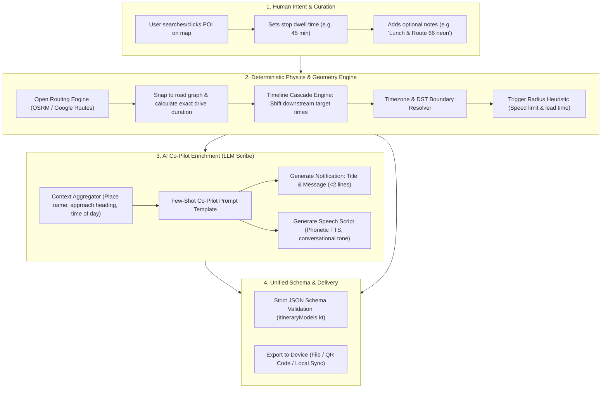
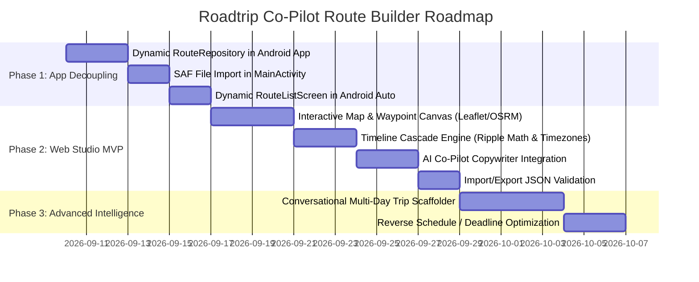

# Roadtrip Co-Pilot: Route Builder Architecture & Research Proposal

## 1. Executive Summary & Problem Context

### The Current State
The Roadtrip Co-Pilot Android application is purpose-built to solve a distinct problem: providing contextual, heads-up in-car awareness (Android Auto notifications, synchronized audio ducking, and real-time pace telemetry) while running strictly in the background alongside Google Maps, with **zero cellular connectivity required**.

Currently, the app relies on bundled static JSON files (`itinerary.json`, `test_itinerary.json`, `test_itinerary_return.json`) embedded directly in the APK's `assets/` directory. The production itinerary (a 4-day trip from Phoenix, AZ to Albuquerque, NM) was the result of extensive human curation in a Google Doc, which was subsequently transformed into the app's JSON schema by an AI agent. 

### The Problem
While the in-car runtime execution is robust, the **authoring and itinerary management pipeline is completely manual and developer-dependent**:
1. **No Authoring or Editing UI:** Modifying a trip (e.g., adding a stop at Montezuma Castle on Day 1, inserting a lunch break in Gallup, or swapping lodging in Chama) requires either manually editing raw JSON or re-prompting an AI agent and manually pasting JSON into the codebase.
2. **The "Ripple Effect" Complexity:** Adding, removing, or reordering a waypoint is not a simple database row insertion. It cascades across multiple dimensions:
   - **Driving distances and transit times** between the preceding and succeeding stops change.
   - **Target arrival and departure times** shift forward or backward for all subsequent stops.
   - **Timezone transitions** (e.g., AZ MST $\to$ NM MDT) must be observed across state borders.
   - **Geofence trigger radiuses** must be calibrated based on approach road speeds and sightlines.
   - **Glanceable notification text and spoken TTS scripts** must be written to match the approach direction, scenic context, and driver mental load.
3. **The Deployment Barrier:** Currently, route choices are hardcoded in `MainActivity.kt` and `RouteListScreen.kt`. Adding a trip requires recompiling the Android APK with Gradle and sideloading it via ADB.

### The Objective of this Research
This document explores the design, feasibility, scope, and architecture for a **Roadtrip Co-Pilot Route Builder**. It examines whether deterministic code or AI is best suited for the task, evaluates platform form factors (Web vs. Native Android vs. Agent), defines the MVP feature set, and outlines an end-to-end architecture that allows any human to easily plan, adjust, and deploy custom road trip itineraries to their vehicle.

---

## 2. Deterministic Code vs. AI Intelligence: The "Engine + Scribe" Pattern

A central question is: *How was the original route data created by AI, and can deterministic code accomplish the same thing?*

The answer lies in recognizing that itinerary authoring is fundamentally two distinct problems masquerading as one:
1. **A Physical / Geometric / Chronological Problem** (Distance, road network routing, driving durations, timeline cascades, timezone shifts).
2. **A Creative / Semantic / Contextual Problem** (Curating scenic sights, driver tips, glanceable alert copywriting, natural spoken phonetic scripts).

Attempting to solve either half with the wrong tool produces poor results:
- **A Pure LLM approach** suffers from temporal hallucinations (e.g., miscalculating drive times, getting math wrong when cascading 45 minutes across 6 stops, or guessing inaccurate coordinates).
- **A Pure Deterministic approach** (like standard Google Maps or an Excel sheet) produces rigid turn directions, but cannot write evocative, contextual co-pilot announcements or understand why a certain vista is worth a 2-mile advance heads-up.

The optimal solution is a **Hybrid "Engine + Scribe" Architecture**:



### What Deterministic Code Does Best
1. **Road Network Routing & Travel Time:**
   - Using an open routing engine (e.g., Open Source Routing Machine - **OSRM**, **Valhalla**, or **GraphHopper**), deterministic code queries the exact road graph between coordinate pairs.
   - It returns the true road distance (not Euclidean line-of-sight), the turn polyline for map rendering, and realistic drive duration based on highway vs. local road speed profiles.
2. **The Timeline Cascade (Schedule Ripple Math):**
   - If Waypoint $k$ is added between $k-1$ and $k+1$ with a dwell duration $D_k$:
     $$\text{Arrival}_k = \text{Departure}_{k-1} + \text{DriveDuration}(W_{k-1}, W_k)$$
     $$\text{Departure}_k = \text{Arrival}_k + D_k$$
     $$\text{Arrival}_{k+1} = \text{Departure}_k + \text{DriveDuration}(W_k, W_{k+1})$$
   - All subsequent waypoints $W_{k+2} \dots W_n$ shift forward by:
     $$\Delta t = (\text{Arrival}_{k+1, \text{new}} - \text{Arrival}_{k+1, \text{old}})$$
   - Deterministic date/time libraries (`java.time` on Android, Python `zoneinfo`, or JS `Temporal`/`date-fns-tz`) execute this with microsecond precision and zero hallucination risk, automatically handling crossing between Arizona (UTC-7 year-round) and New Mexico (UTC-6 during Daylight Saving Time).
3. **Trigger Radius Sizing Heuristics:**
   - The trigger radius dictates how far in advance an alert fires. Deterministic heuristics can automatically set safe defaults based on the road classification:
     - **Interstate / Open Highway (65–75 mph):** $3.0\text{ to }6.0\text{ miles}$ ($\sim 2.5\text{ to }5\text{ minutes}$ advance warning for distant peaks or highway viewings like Shiprock or Bell Rock).
     - **Scenic Byway / Switchback (25–45 mph):** $1.5\text{ to }2.5\text{ miles}$ ($\sim 2\text{ to }3\text{ minutes}$ advance notice before a scenic pull-off).
     - **Urban Approach / Parking / Lodging Destination:** $0.3\text{ to }0.75\text{ miles}$ (triggers right as the car exits the main roadway into the facility).

### What AI / LLMs Do Best
1. **Contextual Co-Pilot Copywriting:**
   - Generating short, glanceable text for the car screen and fluid, natural spoken copy for TTS.
   - Example from the PHX $\to$ ABQ trip:
     - *Raw data:* Shiprock Peak, coordinates `(36.6872, -108.6875)`, approach via US-491 N.
     - *Deterministic output:* "Approaching Shiprock Peak in 6 miles."
     - *AI Co-Pilot output:* 
       - **Title:** `"Shiprock Landmark Ahead"`
       - **Message:** `"1,583-ft volcanic peak visible for miles. View from highway only (sacred tribal land)."`
       - **Speech:** `"Upcoming sight on your left: Shiprock Peak, rising fifteen hundred feet from the desert floor. Highway viewing only as this is sacred Navajo land."`
2. **Pronunciation & TTS Tuning:**
   - Android's offline `TextToSpeech` engine can stumble over abbreviations. The AI formats text for speech (e.g., writing out `"Highway one seventy-nine"` instead of `"AZ-179"`, or clarifying regional pronunciations like `"Chama"` or `"Jicarilla Apache"`).
3. **Conversational Trip Scaffolding & Brain Dump Ingestion:**
   - Allowing a human to paste an unformatted block of notes ("Leaving Phoenix airport rental car center around 2:30pm, want to drive through Sedona on 89A, stop at Bell Rock, then sleep in Flagstaff at Little America Hotel, dinner at Lumberyard Brewing") and transforming it into an initial candidate sequence of stops.

---

## 3. Platform & Form Factor Evaluation

Where should the Route Builder live?

| Form Factor | Pros | Cons | Recommendation |
| :--- | :--- | :--- | :--- |
| **A. Desktop/Tablet Web Application** (e.g., React / Vite / MapLibre / Tailwind) | • Full desktop screen space for dual-pane map & timeline.<br>• Natural ergonomics for trip planning (tabs open for hotels, Reddit, reviews).<br>• Zero app store or APK distribution barriers.<br>• Easy calling of LLM APIs (Gemini/OpenAI) and open routing APIs.<br>• Direct JSON export or QR code sync to phone. | • Requires hosting or running locally (`localhost`).<br>• Not native to the phone. | **PRIMARY RECOMMENDATION (Tier 1)**<br>Best authoring experience by far. |
| **B. Native Android In-App Route Builder** (Phone UI in Kotlin / Compose) | • All-in-one package inside the existing APK.<br>• Works directly on the device that runs the co-pilot. | • Planning a 4-day trip on a 6-inch phone screen is tedious.<br>• High Android UI development overhead (interactive draggable map timelines).<br>• Cannot be used while driving (Android Auto blocks complex interaction). | **SECONDARY / SCOPED TO ON-ROAD TWEAKS**<br>Only build simple on-phone tweaks (e.g. delay start +30m, skip stop). |
| **C. CLI / Script Tool** (Python / Node CLI) | • Fastest to prototype.<br>• Easy to script with Google Docs API and LLMs. | • No interactive map.<br>• Hard for non-technical users to visually verify waypoints and geofences. | **INTERNAL DEV UTILITY ONLY** |

### Architectural Conclusion: The Two-Tier Ecosystem
1. **The Route Builder Studio (Web Application):** A clean, desktop-first web application where trips are planned, visualized on a full-screen map, enriched with AI-generated audio/notification copy, and exported.
2. **Dynamic Ingestion in Android App:** Updating the native Android app so it can dynamically import, list, and switch between custom itineraries stored in the phone's internal storage (`filesDir`), completely eliminating the need to recompile the APK for new trips.

---

## 4. Proposed Architecture & System Components

### 4.1 Schema Evolution (`itinerary.json` v2)
The current schema works well for static execution, but benefits from minor backward-compatible enhancements to support dynamic authoring:

```json
{
  "trip_name": "Phoenix to Albuquerque Road Trip",
  "dates": {
    "start": "2026-10-09",
    "end": "2026-10-12"
  },
  "metadata": {
    "version": "2.0.0",
    "author": "Eric",
    "created_at": "2026-09-08T12:00:00Z"
  },
  "days": [
    {
      "day": 1,
      "date": "2026-10-09",
      "timezone": "America/Phoenix",
      "title": "Red Rock Entry & Oak Creek Canyon Switchbacks",
      "origin": "Phoenix Sky Harbor International Airport (PHX)",
      "destination": "Flagstaff, AZ",
      "departure_time": "14:30:00",
      "checkpoints": [
        {
          "id": "phx_rental_pickup",
          "name": "PHX Rental Car Facility",
          "type": "origin",
          "lat": 33.4357,
          "lng": -112.0152,
          "target_time": "14:30:00",
          "dwell_minutes": 0,
          "trigger_radius_miles": 0.5,
          "notification": {
            "title": "Road Trip Begins!",
            "message": "Departing PHX via I-17 N towards Sedona.",
            "speech": "Welcome to Arizona. We are departing Phoenix heading north on I-17 toward Sedona."
          }
        },
        {
          "id": "sedona_bell_rock",
          "name": "Sedona Red Rock Vistas (Bell Rock Pull-off)",
          "type": "scenic_pull_off",
          "lat": 34.8010,
          "lng": -111.7645,
          "target_time": "16:30:00",
          "dwell_minutes": 30,
          "trigger_radius_miles": 3.0,
          "notification": {
            "title": "Approaching Sedona Red Rocks",
            "message": "Target arrival: 4:30 PM. Recommended 30-min stop for red rock vistas.",
            "speech": "Approaching Sedona on Highway 179. Pull-offs for Bell Rock and Courthouse Butte coming up in two miles."
          }
        }
      ]
    }
  ]
}
```

#### Key Schema Enhancements:
- **`dwell_minutes` (Optional integer):** Explicitly tracks how long the traveler plans to stay at a stop (e.g., 0 for a drive-by vista or pass, 15 for a photo pull-off, 45 for lunch, 60 for dinner). This is the key lever that drives the deterministic ripple engine.
- **`type` (Optional enum):** `["origin", "destination", "scenic_pull_off", "scenic_drive_by", "meal", "fuel", "lodging"]`. Helps both the UI render distinctive map icons and the AI generate appropriately targeted commentary.
- **Backward Compatibility:** Because all new fields are optional, existing app code (`ItineraryModels.kt`) can parse v2 itineraries without breaking.

---

### 4.2 The Ripple / Schedule Cascade Engine

The ripple engine enforces timeline coherence across waypoints within a day:

```
[Waypoint 1: Depart PHX @ 14:30]
         │
         ▼  (Drive: 1h 45m via I-17 / AZ-179)
[Waypoint 2: Bell Rock Arrival @ 16:15]
         │
         ▼  (Dwell: 30 mins)
[Bell Rock Departure @ 16:45]
         │
         ▼  (Drive: 30m via AZ-89A)
[Waypoint 3: Oak Creek Switchbacks Arrival @ 17:15]
```

#### Algorithm:
1. **Anchor Point:** User sets the day's departure time (e.g., `14:30:00`).
2. **Sequential Drive Times:** The system queries OSRM for each consecutive pair $(W_i, W_{i+1})$, caching distance in miles and drive duration in seconds.
3. **Arrival & Departure Cascading:**
   - $\text{Arrival}_1 = \text{DayDepartureTime}$
   - $\text{Departure}_1 = \text{Arrival}_1 + \text{Dwell}_1$
   - $\text{Arrival}_2 = \text{Departure}_1 + \text{Duration}(W_1, W_2)$
   - $\text{Departure}_2 = \text{Arrival}_2 + \text{Dwell}_2$
   - $\dots$
   - $\text{Arrival}_n = \text{Departure}_{n-1} + \text{Duration}(W_{n-1}, W_n)$
4. **Timezone Adjustments:** If Waypoint $i$ and Waypoint $i+1$ reside in different IANA timezones (e.g., crossing from `America/Phoenix` to `America/Denver`), the engine detects the boundary via polygon/coordinate lookup and applies the timezone delta (+1 hour during daylight saving time) to the formatted target string while keeping the underlying epoch timestamps chronologically sound.
5. **Backwards Scheduling Mode ("The Flight Catch-up"):**
   - On departure days (e.g., Day 4 heading to Albuquerque Sunport), users often have a hard deadline (e.g., *"Must be at ABQ airport by 16:30 for car return and flight check-in"*).
   - The engine can reverse-calculate: working backward from destination target time minus all drive durations and dwell times to dictate: *"You must depart Taos Plaza no later than 09:45 AM."*

---

### 4.3 Routing & Geocoding Service Layer

To ensure the Route Builder remains lightweight, cost-effective, and independent of proprietary lock-in:

1. **Routing Provider (Free / Zero Key):**
   - **OSRM Public API (`router.project-osrm.org`):** Free driving directions, returns full geometry and durations.
   - **Fallback / Local Option:** Users can point to an OSRM docker container or use GraphHopper / Mapbox / Google Routes if an API key is provided.
2. **Geocoding & Place Search:**
   - **Nominatim / OpenStreetMap:** Free address and POI geocoding.
   - **Optional Google Places API:** For users who want auto-complete with ratings and phone numbers.

---

### 4.4 The AI Co-Pilot Prompting & Copywriting Pipeline

When a waypoint is created or edited, the human can either type their own notification/speech text or click **"Generate Co-Pilot Speech & Alerts"**. 

#### The Prompting Contract:
```
You are the Roadtrip Co-Pilot writing assistant. You write concise, high-priority
in-car alert cards and spoken audio prompts for an offline Android Auto co-pilot.

Context:
- Waypoint Name: {name}
- Type: {type} (e.g. scenic_pull_off, highway_vista, fuel, lodging)
- Target Arrival Time: {target_time} ({formatted_time})
- Approach Road: {approach_highway} (e.g. AZ-89A North)
- User Notes: {notes}

Requirements:
1. Title: Under 30 characters. Suitable for Android Auto heads-up card.
2. Message: 1-2 concise lines. Include target time and key driving or stopping tip.
3. Speech: Written for offline Android TextToSpeech.
   - Tone: Friendly, professional co-pilot.
   - Pronunciation: Spell out highway numbers naturally (e.g. "Highway one seventy-nine", not "AZ-179").
   - Length: 15-25 words (must speak completely within 8-12 seconds to minimize music ducking).
   - Orientation: Mention sightline relative to the car if known (e.g. "on your left", "pull-off on your right").
4. Recommended Trigger Radius: Suggest a radius in miles (0.3 to 6.0) based on approach road speed.

Respond in strict JSON:
{
  "title": "...",
  "message": "...",
  "speech": "...",
  "recommended_trigger_radius_miles": 2.0
}
```

---

### 4.5 Android App Integration: Dynamic Route Ingestion

To make custom routes immediately usable in the car, the native Android app requires a straightforward upgrade:

```
[Web Route Builder]
        │
        ├──> Direct JSON Download ("my_vacation.json")
        └──> Display Local QR Code / Wi-Fi Sync Link
                    │
                    ▼
[Android Phone (Pixel 7 Pro)]
        │
        ├── Action A: User opens "Roadtrip Co-Pilot" -> Taps "Import Itinerary"
        │            (Native SAF file picker loads .json from Downloads)
        │
        ├── Action B: ADB command (for developers):
        │            adb push my_vacation.json /sdcard/Android/data/com.roadtrip.copilot/files/itineraries/
        │
        └── CopilotService / MainActivity:
                     │
                     ▼
         [Dynamic RouteRepository]
         • Scans /files/itineraries/
         • Merges with bundled assets/ defaults
         • Dynamically populates MainActivity spinner
         • Dynamically populates Android Auto RouteListScreen
```

#### Code Modifications in App:
1. **`RouteRepository.kt` (New Singleton):**
   - Discovers all `.json` files in `context.getExternalFilesDir("itineraries")` or `context.filesDir`.
   - Reads bundled assets (`itinerary.json`, `test_itinerary.json`) as fallbacks.
   - Exposes a unified list of available routes to `MainActivity` and `RouteListScreen`.
2. **`MainActivity.kt`:**
   - Add an **"Import Route"** button that launches `ActivityResultContracts.OpenDocument()`.
   - Copies the selected JSON into the app's internal storage and refreshes the route spinner.
3. **`RouteListScreen.kt` (Android Auto):**
   - Replace the hardcoded `availableRoutes` list with dynamic entries loaded from `RouteRepository`.

---

## 5. Functional MVP Feature Set (What to Build First)

To create a true, working route builder without falling into the trap of over-engineering a full commercial SaaS:

### MVP Scope (The "Sweet Spot"):
1. **Interactive Map Canvas (Web Studio):**
   - Render OpenStreetMap tiles using Leaflet or MapLibre GL.
   - Click anywhere on the map to place a new checkpoint pin, or search via address/place search bar.
   - Draw the real driving polyline between waypoints using free public OSRM.
2. **Timeline / Waypoint Sidebar:**
   - Chronological list of waypoints for each day.
   - Drag-and-drop to reorder stops.
   - Set **Departure Time** for the day.
   - Per-waypoint inputs: **Name**, **Dwell Time (minutes)**, **Trigger Radius (miles)**.
   - Automatic cascade calculation: Displays computed arrival time for every stop.
3. **AI Co-Pilot Assistant:**
   - Single button on each waypoint: **"Generate Co-Pilot Speech & Alert"**.
   - Input for user's own LLM API key (e.g., Gemini API or OpenAI API) stored locally in `localStorage`.
   - Live preview of the generated Android Auto notification card and speech text.
4. **Import & Export:**
   - **"Load Existing JSON":** Drag-and-drop `itinerary.json` to inspect and edit the existing Phoenix-Albuquerque trip.
   - **"Export Itinerary":** Validates JSON schema and downloads a ready-to-run `.json` file.
5. **Android App Ingestion:**
   - Add the SAF File Picker ("Import Itinerary") to `MainActivity.kt` so the exported file can be loaded directly from the phone's Download folder without opening a terminal or recompiling the app.

---

## 6. Implementation Roadmap & Phasing



### Phase 1: Decouple the Android App (Immediate Prerequisite)
* **Goal:** Enable the app to run arbitrary user-supplied itineraries.
* **Deliverables:**
  - Create `RouteRepository.kt` to scan `files/itineraries/`.
  - Add "Import Itinerary" button to `activity_main.xml`.
  - Update `RouteListScreen.kt` to query `RouteRepository.getAvailableRoutes()`.

### Phase 2: Web Studio MVP
* **Goal:** Deliver the visual, map-based authoring tool with deterministic cascades and AI speech writing.
* **Tech Stack:** React + Vite + TypeScript, Leaflet / MapLibre, Tailwind CSS, OSRM Public API, Gemini Flash API.
* **Deliverables:**
  - Map with route lines and draggable waypoints.
  - Cascade schedule calculator with timezone detection.
  - AI Co-Pilot alert generator.
  - JSON importer/exporter.

### Phase 3: Advanced Intelligence & On-Road Enhancements (Future Stretch)
* **Goal:** Full conversational trip generation and smart on-road adjustments.
* **Deliverables:**
  - "Plan a 3-day trip through Utah's Mighty 5" conversational scaffolding.
  - In-app Android quick-adjustments: "Push today's schedule by 30 minutes", "Skip upcoming stop".

---

## 7. Summary & Verdict

Building a dedicated Route Builder is a natural and high-value progression for the Roadtrip Co-Pilot project. 

By separating the problem into **deterministic road graph/timeline math** and **AI contextual copywriting**, we avoid the pitfalls of hallucinated travel times while preserving the rich, evocative co-pilot personality that makes the app uniquely compelling. 

Prioritizing a **desktop-first Web Studio MVP** combined with **dynamic route loading in the Android app** delivers the greatest ergonomic payoff for future road trips with minimal engineering friction.
