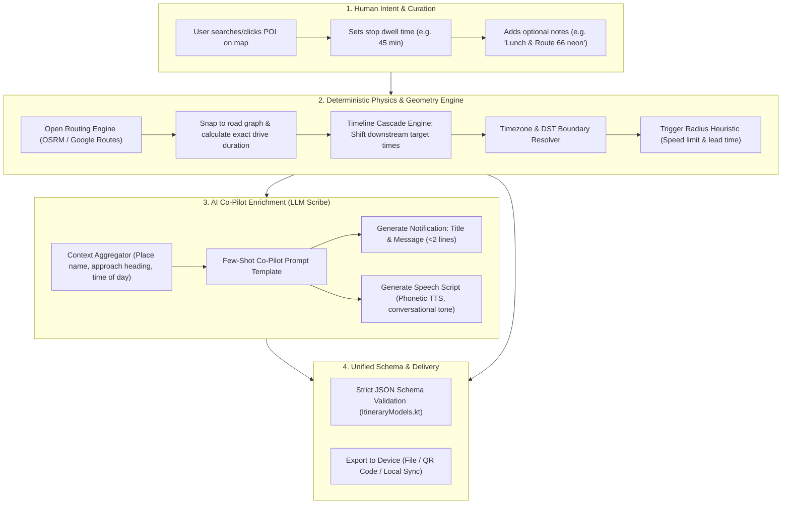
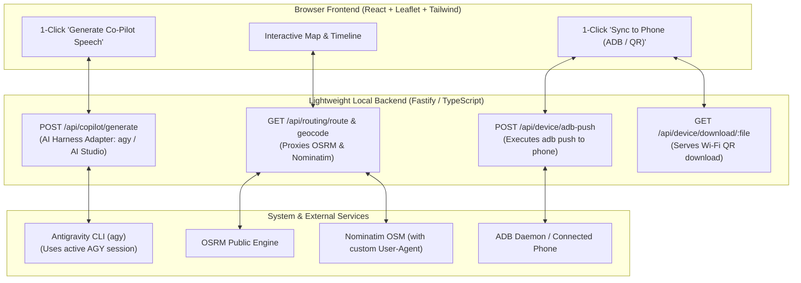

# Roadtrip Co-Pilot: Route Builder Architecture & Research Proposal

> [!NOTE]
> **IMPLEMENTATION STATUS: COMPLETE & IN PRODUCTION**  
> The architectural design and mathematical specifications in this proposal have been fully implemented in the Route Builder Web Studio (`route-builder/`) and the native Android app (`app/src/main/java/com/roadtrip/copilot/`).  
> This document remains the authoritative engineering reference for domain logic, timeline cascade formulas, OSRM/Nominatim contracts, and the "Engine + Scribe" architecture.

## 1. Executive Summary & Problem Context

### The Current State
The Roadtrip Co-Pilot Android application is purpose-built to solve a distinct problem: providing contextual, heads-up in-car awareness (Android Auto notifications, synchronized audio ducking, and real-time pace telemetry) while running strictly in the background alongside Google Maps, with **zero cellular connectivity required**.

Initially, the app relied on bundled static JSON files (`itinerary.json`, `test_itinerary.json`, `test_itinerary_return.json`) embedded in the APK's `assets/` directory. Creating or modifying itineraries required manually formatting coordinates, target timestamps, and alert copy into JSON.

### The Problem
While the in-car runtime execution is robust, the **authoring and itinerary management pipeline was completely manual and developer-dependent**:
1. **No Authoring or Editing UI:** Modifying a trip (e.g., adding a scenic viewpoint, inserting a lunch stop, or swapping lodging) required either manually editing raw JSON or prompting an external model and manually pasting JSON into the codebase.
2. **The "Ripple Effect" Complexity:** Adding, removing, or reordering a waypoint is not a simple row insertion. It cascades across multiple dimensions:
   - **Driving distances and transit times** between the preceding and succeeding stops change.
   - **Target arrival and departure times** shift forward or backward for all subsequent stops.
   - **Timezone transitions** must be observed across state or timezone borders.
   - **Geofence trigger radiuses** must be calibrated based on approach road speeds and sightlines.
   - **Glanceable notification text and spoken TTS scripts** must be written to match the approach direction, scenic context, and driver mental load.
3. **The Deployment Barrier:** Originally, route choices were hardcoded in the Android app. Adding a trip required recompiling the APK with Gradle and sideloading it via ADB.

### The Objective of this Research
This document explores the design, feasibility, scope, and architecture for a **Roadtrip Co-Pilot Route Builder**. It examines whether deterministic code or AI is best suited for the task, evaluates platform form factors (Web vs. Native Android vs. Agent), defines the MVP feature set, and outlines an end-to-end architecture that allows any human to easily plan, adjust, and deploy custom road trip itineraries to their vehicle.

---

## 2. Deterministic Code vs. AI Intelligence: The "Engine + Scribe" Pattern

A central question is: *How was the original route data created by AI, and can deterministic code accomplish the same thing?*

The answer lies in recognizing that itinerary authoring is fundamentally two distinct problems masquerading as one:
1. **A Physical / Geometric / Chronological Problem** (Distance, road network routing, driving durations, timeline cascades, timezone shifts).
2. **A Creative / Semantic / Contextual Problem** (Curating scenic sights, driver tips, glanceable alert copywriting, natural spoken phonetic scripts).

Attempting to solve either half with the wrong tool produces poor results:
- **A Pure LLM approach** suffers from temporal hallucinations (e.g., miscalculating drive times, getting math wrong when cascading 45 minutes across 6 stops, or guessing inaccurate coordinates).
- **A Pure Deterministic approach** (like standard Google Maps or an Excel sheet) produces rigid turn directions, but cannot write evocative, contextual co-pilot announcements or understand why a certain vista is worth a 2-mile advance heads-up.

The optimal solution is a **Hybrid "Engine + Scribe" Architecture**:



### What Deterministic Code Does Best
1. **Road Network Routing & Travel Time:**
   - Using an open routing engine (e.g., Open Source Routing Machine - **OSRM**, **Valhalla**, or **GraphHopper**), deterministic code queries the exact road graph between coordinate pairs.
   - It returns the true road distance (not Euclidean line-of-sight), the turn polyline for map rendering, and realistic drive duration based on highway vs. local road speed profiles.
2. **Google Maps Navigation Links & Route-Shaping Waypoints:**
   - *The In-Car Reality:* Android Auto will run Google Maps on the main screen for active turn-by-turn guidance, while Roadtrip Co-Pilot runs in the background.
   - *The Problem:* Google Maps navigation algorithms default to the fastest time or shortest distance. If you simply navigate between distant endpoints, Google Maps will keep you on interstates and bypass scenic byways completely, or aggressively offer reroutes away from scenic backroads and mountain passes.
   - *The Solution:* The Route Builder must generate multi-stop **Google Maps Navigation URLs** (`https://www.google.com/maps/dir/?api=1&origin=...&destination=...&waypoints=...&travelmode=driving`) containing strategic "route-shaping" waypoints. When opened on the car's connected phone, this forces Google Maps to navigate the exact scenic itinerary intended by the co-pilot.
   - *URL Limits & Leg Chunking:* Google Maps URLs support up to 9 intermediate waypoints plus origin and destination (11 total points). For days with extensive stops, the Route Builder automatically partitions the day into logical driving legs (e.g. Morning Leg $\to$ Afternoon Leg) and provides 1-click links or QR codes.
3. **The Timeline Cascade (Schedule Ripple Math):**
   - If Waypoint $k$ is added between $k-1$ and $k+1$ with a dwell duration $D_k$:
     $$\text{Arrival}_k = \text{Departure}_{k-1} + \text{DriveDuration}(W_{k-1}, W_k)$$
     $$\text{Departure}_k = \text{Arrival}_k + D_k$$
     $$\text{Arrival}_{k+1} = \text{Departure}_k + \text{DriveDuration}(W_k, W_{k+1})$$
   - All subsequent waypoints $W_{k+2} \dots W_n$ shift forward by:
     $$\Delta t = (\text{Arrival}_{k+1, \text{new}} - \text{Arrival}_{k+1, \text{old}})$$
   - Deterministic date/time libraries execute this precisely, automatically handling cross-state and daylight saving timezone boundary crossings.
4. **Trigger Radius Sizing Heuristics:**
   - The trigger radius dictates how far in advance an alert fires. Deterministic heuristics can automatically set safe defaults based on the road classification:
     - **Interstate / Open Highway (65–75 mph):** $3.0\text{ to }6.0\text{ miles}$ ($\sim 2.5\text{ to }5\text{ minutes}$ advance warning for distant peaks or highway viewings).
     - **Scenic Byway / Switchback (25–45 mph):** $1.5\text{ to }2.5\text{ miles}$ ($\sim 2\text{ to }3\text{ minutes}$ advance notice before a scenic pull-off).
     - **Urban Approach / Parking / Lodging Destination:** $0.3\text{ to }0.75\text{ miles}$ (triggers right as the car exits the main roadway into the facility).

### What AI / LLMs Do Best
1. **Contextual Co-Pilot Copywriting:**
   - Generating short, glanceable text for the car screen and fluid, natural spoken copy for TTS.
   - Example scenic alert:
     - *Raw data:* Landmark Peak, approach via State Highway.
     - *Deterministic output:* "Approaching Landmark Peak in 3 miles."
     - *AI Co-Pilot output:* 
       - **Title:** `"Landmark Peak Ahead"`
       - **Message:** `"Scenic volcanic peak visible for miles. View from designated pull-offs."`
       - **Speech:** `"Upcoming sight on your left: Landmark Peak, rising from the valley floor. Scenic pull-offs coming up in two miles."`
2. **Pronunciation & TTS Tuning:**
   - Android's offline `TextToSpeech` engine can stumble over abbreviations and regional names. The AI formats text for speech (e.g., writing out `"Highway one seventy-nine"` instead of `"AZ-179"`, or phonetically spelling challenging regional landmarks).
3. **Conversational Trip Scaffolding & Brain Dump Ingestion:**
   - Allowing a user to paste an unformatted block of trip notes (e.g. "Departing airport around 2:30pm, driving the mountain switchbacks, stopping at the scenic overlook for photos, and sleeping at the alpine lodge") and transforming it into an initial candidate sequence of stops.

---

## 3. Platform & Form Factor Evaluation

Where should the Route Builder live?

| Form Factor | Pros | Cons | Recommendation |
| :--- | :--- | :--- | :--- |
| **A. Full-Stack Web Application** (React Frontend + Lightweight Node/Express or Fastify Backend) | • Full desktop screen space for dual-pane map & timeline.<br>• Native backend integration with **agy CLI** (zero API keys, reuses active Antigravity session).<br>• Backend proxies Nominatim & OSRM (solves CORS & custom User-Agent headers).<br>• 1-click **ADB Push** to connected phone and local Wi-Fi QR code server.<br>• Local filesystem persistence directly in repo (`trips/` folder). | • Requires running locally (e.g. `npm run dev`). | **PRIMARY RECOMMENDATION (Tier 1)**<br>Best authoring experience, zero-config AI, and effortless device sync. |
| **B. Native Android In-App Route Builder** (Phone UI in Kotlin / Compose) | • All-in-one package inside the existing APK.<br>• Works directly on the device that runs the co-pilot. | • Planning a 4-day trip on a 6-inch phone screen is tedious.<br>• High Android UI development overhead (interactive draggable map timelines).<br>• Cannot be used while driving (Android Auto blocks complex interaction). | **SECONDARY / SCOPED TO ON-ROAD TWEAKS**<br>Only build simple on-phone tweaks (e.g. delay start +30m, skip stop). |
| **C. CLI / Script Tool** (Python / Node CLI) | • Fastest to prototype.<br>• Easy to script with Google Docs API and LLMs. | • No interactive map.<br>• Hard for non-technical users to visually verify waypoints and geofences. | **INTERNAL DEV UTILITY ONLY** |

### Architectural Conclusion: The Two-Tier Ecosystem
1. **The Route Builder Studio (Full-Stack Web Application):** A clean, desktop-first web application (React frontend + lightweight Node backend) where trips are planned, visualized on a full-screen map, enriched with AI-generated audio/notification copy via the local `agy` CLI or Google AI Studio, and synced directly to the phone via ADB or local Wi-Fi.
2. **Dynamic Ingestion in Android App:** Updating the native Android app so it can dynamically import, list, and switch between custom itineraries stored in the phone's internal storage (`filesDir`), completely eliminating the need to recompile the APK for new trips.

---

## 4. Proposed Architecture & System Components

### 4.1 Schema Evolution (`itinerary.json` v2)
The current schema works well for static execution, but benefits from minor backward-compatible enhancements to support dynamic authoring:

```json
{
  "trip_name": "Scenic Mountain Road Trip",
  "dates": {
    "start": "2026-10-09",
    "end": "2026-10-12"
  },
  "metadata": {
    "version": "2.0.0",
    "author": "Roadtripper",
    "created_at": "2026-09-08T12:00:00Z"
  },
  "days": [
    {
      "day": 1,
      "date": "2026-10-09",
      "timezone": "America/Phoenix",
      "title": "Mountain Foothills & Canyon Switchbacks",
      "origin": "Valley Regional Airport",
      "destination": "Alpine Lodge",
      "departure_time": "14:30:00",
      "checkpoints": [
        {
          "id": "airport_rental_pickup",
          "name": "Airport Rental Facility",
          "type": "origin",
          "lat": 33.4357,
          "lng": -112.0152,
          "target_time": "14:30:00",
          "dwell_minutes": 0,
          "trigger_radius_miles": 0.5,
          "notification": {
            "title": "Road Trip Begins!",
            "message": "Departing northbound towards the scenic canyon.",
            "speech": "Welcome! We are departing heading north toward the mountain pass."
          }
        },
        {
          "id": "sedona_bell_rock",
          "name": "Sedona Red Rock Vistas (Bell Rock Pull-off)",
          "type": "scenic_pull_off",
          "lat": 34.8010,
          "lng": -111.7645,
          "target_time": "16:30:00",
          "dwell_minutes": 30,
          "trigger_radius_miles": 3.0,
          "notification": {
            "title": "Approaching Sedona Red Rocks",
            "message": "Target arrival: 4:30 PM. Recommended 30-min stop for red rock vistas.",
            "speech": "Approaching Sedona on Highway 179. Pull-offs for Bell Rock and Courthouse Butte coming up in two miles."
          }
        }
      ]
    }
  ]
}
```

#### Key Schema Enhancements:
- **`dwell_minutes` (Optional integer):** Explicitly tracks how long the traveler plans to stay at a stop (e.g., 0 for a drive-by vista or pass, 15 for a photo pull-off, 45 for lunch, 60 for dinner). This is the key lever that drives the deterministic ripple engine.
- **`type` (Optional enum):** `["origin", "destination", "scenic_pull_off", "scenic_drive_by", "meal", "fuel", "lodging"]`. Helps both the UI render distinctive map icons and the AI generate appropriately targeted commentary.
- **Backward Compatibility:** Because all new fields are optional, existing app code (`ItineraryModels.kt`) can parse v2 itineraries without breaking.

---

### 4.2 The Ripple / Schedule Cascade Engine

The ripple engine enforces timeline coherence across waypoints within a day:

```
[Waypoint 1: Depart PHX @ 14:30]
         │
         ▼  (Drive: 1h 45m via I-17 / AZ-179)
[Waypoint 2: Bell Rock Arrival @ 16:15]
         │
         ▼  (Dwell: 30 mins)
[Bell Rock Departure @ 16:45]
         │
         ▼  (Drive: 30m via AZ-89A)
[Waypoint 3: Oak Creek Switchbacks Arrival @ 17:15]
```

#### Algorithm:
1. **Anchor Point:** User sets the day's departure time (e.g., `14:30:00`).
2. **Sequential Drive Times:** The system queries OSRM for each consecutive pair $(W_i, W_{i+1})$, caching distance in miles and drive duration in seconds.
3. **Arrival & Departure Cascading:**
   - $\text{Arrival}_1 = \text{DayDepartureTime}$
   - $\text{Departure}_1 = \text{Arrival}_1 + \text{Dwell}_1$
   - $\text{Arrival}_2 = \text{Departure}_1 + \text{Duration}(W_1, W_2)$
   - $\text{Departure}_2 = \text{Arrival}_2 + \text{Dwell}_2$
   - $\dots$
   - $\text{Arrival}_n = \text{Departure}_{n-1} + \text{Duration}(W_{n-1}, W_n)$
4. **Timezone Adjustments:** If Waypoint $i$ and Waypoint $i+1$ reside in different IANA timezones (e.g., crossing from `America/Phoenix` to `America/Denver`), the engine detects the boundary via polygon/coordinate lookup and applies the timezone delta (+1 hour during daylight saving time) to the formatted target string while keeping the underlying epoch timestamps chronologically sound.
5. **Backwards Scheduling Mode ("The Catch-up Solver"):**
   - On departure days heading to an airport or event, users often have a hard deadline (e.g., *"Must be at the airport by 16:30 for flight check-in"*).
   - The engine can reverse-calculate: working backward from destination target time minus all drive durations and dwell times to dictate: *"You must depart your origin no later than 09:45 AM."*

---

### 4.3 Full-Stack Architecture & Lightweight Local Backend

Rather than a fragile client-only Single Page App (SPA), the Route Builder is architected as a **Full-Stack Web Application** (React frontend + lightweight Node/Express or Fastify backend running in a single `npm run dev` workflow). 

A local backend transforms the developer experience and eliminates browser security barriers:



#### Core Backend Responsibilities:
1. **Native `agy` CLI Execution (Zero Configuration):**
   - The frontend calls `POST /api/copilot/generate`. The backend executes `agy -p "..." --output-format json` via child process.
   - Reuses your active, authenticated Antigravity environment and active Gemini 3.8 model. **Zero API keys to create, paste, or manage.**
2. **Compliant Geocoding & Routing Proxies:**
   - **Nominatim Policy Compliance:** OpenStreetMap's geocoder strictly mandates a custom `User-Agent` header (browsers forbid setting `User-Agent` in client-side `fetch()`). The backend proxies `/api/routing/geocode` with compliant identification and rate-limiting.
   - **OSRM Proxy & Caching:** Proxies road routing requests and caches geometry polylines locally in memory/disk so dragging waypoints doesn't trigger CORS or spam public servers.
3. **1-Click Device Sync via ADB:**
   - The backend exposes `POST /api/device/adb-push`. It checks `adb devices` and automatically pushes the generated `.json` directly into the phone's co-pilot directory:
     ```bash
     adb push trips/my_trip.json /sdcard/Android/data/com.roadtrip.copilot/files/itineraries/
     ```
4. **Local Wi-Fi Server for Instant Phone QR Transfer:**
   - The backend serves `GET /api/device/download/:filename` over your home Wi-Fi (`http://<local-ip>:3000/...`).
   - The frontend renders a scannable QR code on screen; pointing your phone's camera at the screen immediately downloads the itinerary into the phone's Download folder for native import.
5. **Local Repository Persistence:**
   - Directly saves and reads `.json` files from a `trips/` folder in the repository, and can write directly into `app/src/main/assets/` if desired.

---

### 4.4 The AI Co-Pilot Prompting & Copywriting Pipeline

When a waypoint is created or edited, the user can type their own notification/speech text or click **"Generate Co-Pilot Speech & Alerts"**. 

#### The Prompting Contract:
```
You are the Roadtrip Co-Pilot writing assistant. You write concise, high-priority
in-car alert cards and spoken audio prompts for an offline Android Auto co-pilot.

Context:
- Waypoint Name: {name}
- Type: {type} (e.g. scenic_pull_off, highway_vista, fuel, lodging)
- Target Arrival Time: {target_time} ({formatted_time})
- Approach Road: {approach_highway} (e.g. AZ-89A North)
- User Notes: {notes}

Requirements:
1. Title: Under 30 characters. Suitable for Android Auto heads-up card.
2. Message: 1-2 concise lines. Include target time and key driving or stopping tip.
3. Speech: Written for offline Android TextToSpeech.
   - Tone: Friendly, professional co-pilot.
   - Pronunciation: Spell out highway numbers naturally (e.g. "Highway one seventy-nine", not "AZ-179").
   - Length: 15-25 words (must speak completely within 8-12 seconds to minimize music ducking).
   - Orientation: Mention sightline relative to the car if known (e.g. "on your left", "pull-off on your right").
4. Recommended Trigger Radius: Suggest a radius in miles (0.3 to 6.0) based on approach road speed.

Respond in strict JSON:
{
  "title": "...",
  "message": "...",
  "speech": "...",
  "recommended_trigger_radius_miles": 2.0
}
```

#### AI Access, Authentication & Pluggable Harness Adapters:

1. **Antigravity CLI (`agy`) Bridge (`AgyHarnessAdapter` — Primary Local Engine):**
   - *How it works:* The local backend queries `agy models` to resolve the newest available Flash model (`gemini-3.8-flash-high`) and invokes:
     ```bash
     agy -p "Write Roadtrip Co-Pilot announcement for..." --model gemini-3.8-flash-high --output-format json
     ```
   - *Key Benefit:* `agy` inherits your active Antigravity session and model tier directly from your environment with zero API keys required.
   - *User Experience:* **Zero configuration.** Works out of the box when running the Route Builder locally.

2. **Google AI Studio API (`GeminiStudioHarnessAdapter` — Cloud Engine):**
   - *How it works:* Direct REST API calls defaulting to `gemini-3.8-flash` using a developer API key from `aistudio.google.com`.
   - *When to use:* If running the Route Builder in a standalone browser environment without the local `agy` CLI installed, or as a deployed web service.
   - *Model Selection:* Configurable via `GEMINI_MODEL` (defaults to `gemini-3.8-flash`).

3. **Pluggable Adapter Architecture & Roadmap:**
   - The backend implements a modular `AiHarnessAdapter` interface (`route-builder/server/services/aiService.ts`), enabling seamless addition of other AI harnesses:
     - Anthropic Claude Adapter
     - OpenAI ChatGPT Adapter
     - Local offline models (Ollama, llama.cpp)
   - Detailed proposals for these providers are tracked in [IDEAS.md](IDEAS.md).

4. **Deterministic Template Fallback (`TemplateHarnessAdapter`):**
   - If neither `agy` nor an API key is available, context-aware deterministic templates generate alerts without failing.

---

### 4.5 Google Maps Navigation Link & Waypoint Injection Generator

While Roadtrip Co-Pilot provides audio ducking, heads-up cards, and pace tracking in the background, **Google Maps on the in-car display does the live turn-by-turn navigation**.

To guarantee that Google Maps navigates the exact scenic road rather than silently rerouting to a faster interstate:

1. **Deterministic Multi-Stop URL Construction:**
   - The Route Builder constructs standard Google Maps Navigation URLs:
     ```
     https://www.google.com/maps/dir/?api=1&origin=33.4357,-112.0152&destination=35.1878,-111.6152&waypoints=34.8010,-111.7645|35.0345,-111.7330&travelmode=driving
     ```
2. **Route-Shaping Waypoints:**
   - Waypoints in the URL serve two purposes:
     - **Physical Stops:** Locations where the car pulls over (Vista Overlook, picnic area, lodging).
     - **Route Anchors:** Strategic highway points placed specifically to prevent Google Maps from rerouting onto boring highways.
3. **URL Waypoint Limits & Leg Chunking:**
   - Google Maps URLs permit up to **9 intermediate waypoints** plus origin and destination (11 points maximum per link).
   - If a day's drive exceeds 9 intermediate waypoints, the Route Builder automatically partitions the day into logical driving legs:
     - `Day 2 - Leg 1: Morning Mountain Drive (Morning)`
     - `Day 2 - Leg 2: Afternoon Canyon to Lake Lodge (Afternoon)`
4. **Handoff Mechanisms to Car Phone:**
   - **QR Code on Screen:** Scan with phone camera to instantly launch Google Maps turn-by-turn.
   - **Web Share API / Copy Link:** 1-click button to send the navigation link via text, email, or messaging.

### 4.6 Android App Integration: Dynamic Route Ingestion

To make custom routes immediately usable in the car, the native Android app requires a straightforward upgrade:

```
[Web Route Builder]
        │
        ├──> Direct JSON Download ("my_vacation.json")
        ├──> Google Maps Multi-Stop Navigation Link (Forces Scenic Route)
        └──> Display Local QR Code / Wi-Fi Sync Link
                    │
                    ▼
[Android Phone (Pixel 7 Pro)]
        │
        ├── Action A: User opens "Roadtrip Co-Pilot" -> Taps "Import Itinerary"
        │            (Native SAF file picker loads .json from Downloads)
        │
        ├── Action B: Tap Google Maps Link -> Launches navigation in Android Auto
        │
        ├── Action C: ADB command (for developers):
        │            adb push my_vacation.json /sdcard/Android/data/com.roadtrip.copilot/files/itineraries/
        │
        └── CopilotService / MainActivity:
                     │
                     ▼
         [Dynamic RouteRepository]
         • Scans /files/itineraries/
         • Merges with bundled assets/ defaults
         • Dynamically populates MainActivity spinner
         • Dynamically populates Android Auto RouteListScreen
```

#### Code Modifications in App:
1. **`RouteRepository.kt` (New Singleton):**
   - Discovers all `.json` files in `context.getExternalFilesDir("itineraries")` or `context.filesDir`.
   - Reads bundled assets (`itinerary.json`, `test_itinerary.json`, `test_itinerary_return.json`) as fallbacks.
   - Exposes a unified list of available routes to `MainActivity` and `RouteListScreen`.
2. **`MainActivity.kt`:**
   - Add an **"Import Route"** button that launches `ActivityResultContracts.OpenDocument()`.
   - Copies the selected JSON into the app's internal storage and refreshes the route spinner.
3. **`RouteListScreen.kt` (Android Auto):**
   - Replace the hardcoded `availableRoutes` list with dynamic entries loaded from `RouteRepository`.
   - Allows the driver to browse and select any imported route directly from the car's touchscreen.

---

## 5. Functional MVP Feature Set (What to Build First)

To create a true, working route builder without falling into the trap of over-engineering a full commercial SaaS:

### MVP Scope (The "Sweet Spot"):
1. **Full-Stack Web Studio (Frontend + Lightweight Node Backend):**
   - Single command `npm run dev` boots both the React frontend and the lightweight Node API server.
   - Render OpenStreetMap tiles using Leaflet or MapLibre GL.
   - Click anywhere on the map to place a new checkpoint pin, or search via address/place search bar (proxied via backend with compliant Nominatim headers).
   - Draw the real driving polyline between waypoints using backend-proxied OSRM routing.
2. **Timeline / Waypoint Sidebar:**
   - Chronological list of waypoints for each day.
   - Drag-and-drop to reorder stops.
   - Set **Departure Time** for the day.
   - Per-waypoint inputs: **Name**, **Dwell Time (minutes)**, **Trigger Radius (miles)**.
   - Automatic cascade calculation: Displays computed arrival and departure times for every stop.
3. **Google Maps Multi-Stop Navigation Link Generator:**
   - Auto-generates the exact Google Maps navigation URL with route-forcing waypoints so Android Auto doesn't reroute onto the highway.
   - Automatically chunks drives exceeding 9 intermediate waypoints into morning/afternoon legs.
   - Provides a scannable QR code and 1-click "Send to Phone" button.
4. **AI Co-Pilot Assistant (Pluggable Adapters: `agy` CLI + Cloud API):**
   - Single button on each waypoint: **"Generate Co-Pilot Speech & Alert"** (and batch generation for the whole day).
   - Primary: Backend calls `agy` with dynamically resolved Flash model. **Zero API keys or setup required.**
   - Cloud fallback: Direct Google AI Studio API key (`gemini-3.8-flash`) support.
   - Live preview of the generated Android Auto notification card and speech text.
5. **Import, Export & 1-Click Device Sync:**
   - **"Load Existing JSON":** Drag-and-drop or select any itinerary JSON file to inspect and edit.
   - **"Export Itinerary":** Validates JSON schema and downloads a ready-to-run `.json` file.
   - **1-Click ADB Push:** Backend checks `adb devices` and pushes the itinerary directly to the connected phone.
   - **Local Wi-Fi QR Server:** Backend serves the JSON file over the local network so the phone camera scans the QR code to download instantly.
6. **Android App Ingestion:**
   - Use the SAF File Picker ("Import Itinerary") in `MainActivity.kt` to load files directly from phone storage.
   - Dynamic update to Android Auto's `RouteListScreen` to show imported itineraries on the car display.

---

## 6. Implementation Roadmap & Granular Phasing

To ensure no scope is dropped by agents or developers, the project is structured into two sequential, bite-sized phases.

```mermaid
gantt
    title Roadtrip Co-Pilot Route Builder Roadmap
    dateFormat  YYYY-MM-DD
    section Phase 1: Android App Dynamic Storage & Car UI
    Phase 1A: RouteRepository & File Storage Engine  :p1_1, 2026-09-11, 2d
    Phase 1B: Phone UI Import Flow (MainActivity)    :p1_2, after p1_1, 2d
    Phase 1C: Android Auto Dynamic RouteListScreen   :p1_3, after p1_2, 2d
    section Phase 2: Web Studio MVP
    Phase 2A: Full-Stack Shell & Routing Proxy (OSRM):p2_1, after p1_3, 3d
    Phase 2B: Timeline Cascade & Google Maps Links   :p2_2, after p2_1, 3d
    Phase 2C: AI Co-Pilot Enrichment via agy CLI     :p2_3, after p2_2, 3d
    Phase 2D: Export, ADB Push & Wi-Fi Phone Handoff :p2_4, after p2_3, 2d
```

### Phase 1: Android App Dynamic Route Loading & Car UI (Prerequisite)
*Before building the web authoring tool, the Android app must be updated so it can consume arbitrary itineraries without needing a code edit and APK rebuild.*

#### Phase 1A: Storage & Repository Engine (`RouteRepository.kt`)
- Create `RouteRepository` singleton to scan internal storage (`context.filesDir/itineraries/`) and external files.
- Maintain bundled assets (`itinerary.json`, `test_itinerary.json`, `test_itinerary_return.json`) as permanent fallback defaults.
- Handle JSON deserialization, schema validation against `ItineraryModels.kt`, and graceful handling of corrupted files.

#### Phase 1B: Phone UI Import Flow (`MainActivity.kt`)
- Add an **"Import Itinerary"** button to the phone dashboard (`activity_main.xml`).
- Wire to `ActivityResultContracts.OpenDocument()` with MIME type `application/json`.
- On file selection, copy JSON to app storage, validate syntax, and trigger a live reload of the route spinner.

#### Phase 1C: Android Auto Car In-Car UI (`RouteListScreen.kt` & `CopilotService.kt`)
- Replace the hardcoded `availableRoutes` list in `RouteListScreen.kt` with dynamic items queried from `RouteRepository`.
- Ensure switching routes from the car screen smoothly loads checkpoints into `CopilotService` and updates `CopilotDashboardScreen.kt`.

---

### Phase 2: Web Studio MVP (The Route Builder)
*A standalone, desktop-first full-stack web authoring tool (React frontend + lightweight Node backend) running in a single `npm run dev` command.*

#### Phase 2A: Full-Stack Web Shell & Routing Proxy
- React + Vite + TypeScript frontend with Tailwind CSS and Leaflet map canvas.
- Lightweight Node/Express or Fastify backend server.
- Backend routing proxies:
  - `/api/routing/geocode`: Compliant Nominatim proxy setting required User-Agent headers.
  - `/api/routing/route`: OSRM proxy caching driving polylines and durations.
- Address search bar + click-on-map to add pins.

#### Phase 2B: Timeline Cascade Engine & Google Maps Link Generator
- Chronological waypoint sidebar with drag-and-drop reordering.
- Per-waypoint `dwell_minutes` input and day departure time picker.
- Deterministic cascade calculator: computes accurate arrival and departure times for each stop.
- Multi-stop Google Maps Navigation URL generator:
  - Formats multi-stop driving links with route-forcing waypoints.
  - Automatically partitions days with >9 intermediate waypoints into morning and afternoon legs.
  - Generates scannable QR codes and copyable links.

#### Phase 2C: AI Co-Pilot Enrichment via Pluggable Adapters
- Backend endpoint `POST /api/copilot/generate` implementing the `AiHarnessAdapter` pattern.
- Primary: Shells out to `agy`, dynamically resolving the latest Flash model with **zero API key configuration**.
- Cloud fallback: Direct Google AI Studio API (`gemini-3.8-flash`) if an API key is provided.
- "Generate Co-Pilot Speech & Alert" button on each waypoint card with live Android Auto card preview and TTS audio test.

#### Phase 2D: Export, 1-Click ADB Push & Phone Handoff
- Validate output against `ItineraryModels.kt` JSON schema.
- One-click "Export JSON" file download.
- 1-Click "Push to Connected Phone" via backend `adb push`.
- Local Wi-Fi QR code server for wireless phone download.
- Display transfer modal: QR code for the itinerary file and Google Maps navigation links.

---

## 7. Future Horizons & Feature Backlog

*A detailed feature backlog, including multi-provider AI adapters (Anthropic Claude, OpenAI, Ollama), elevation profiles, weather radar overlays, and custom voice narration, is maintained in [IDEAS.md](IDEAS.md).*

Key architectural opportunities include:
- **Multi-Provider AI Harnesses:** Pluggable adapters for Anthropic Claude, OpenAI, and local offline models (Ollama).
- **Conversational Trip Scaffolding:** An agentic chat interface alongside the map ("Plan a 3-day loop along the scenic coastal highway with 3–4 hours of driving per day") that drafts initial waypoints and feeds them into the cascade engine.
- **Elevation & Mountain Pass Awareness:** Querying elevation APIs and solar angle calculators to warn the driver about steep passes or optimize arrival at scenic overlooks during golden hour.
- **Live Weather & Road Condition Alerts:** Ingesting National Weather Service (NWS) feeds to alert for snow, wind, or seasonal road closures.
- **Mobile Route Quick Tweaks:** Mobile convenience controls in `MainActivity` (e.g. "Delay departure by 30 minutes", "Skip next waypoint").

---

## 8. Summary & Verdict

Building a dedicated Route Builder is a natural and high-value progression for the Roadtrip Co-Pilot project. 

By separating the problem into **deterministic road graph/timeline math** and **AI contextual copywriting**, we avoid the pitfalls of hallucinated travel times while preserving the rich, evocative co-pilot personality that makes the app uniquely compelling. 

Prioritizing a **desktop-first Web Studio MVP** combined with **dynamic route loading in the Android app** delivers the greatest ergonomic payoff for future road trips with minimal engineering friction.
