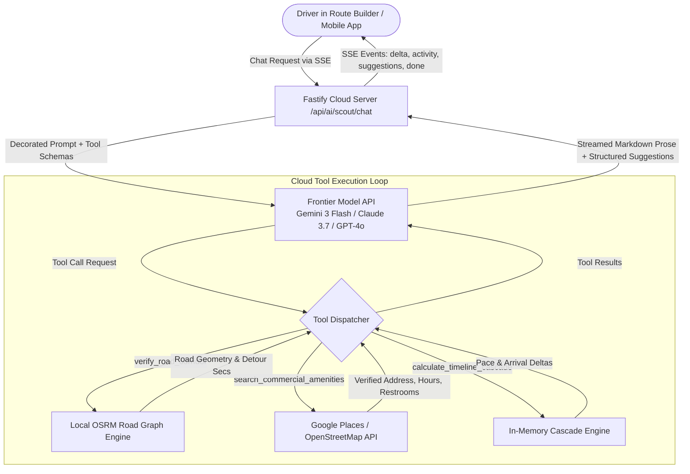

# Route Scout: Cloud Production & Model API Architecture

This document evaluates the architectural transition of **Route Scout** from a local CLI agent harness (`agy`) to direct cloud model APIs (Google Gemini, Anthropic Claude, OpenAI) for future hosted production and multi-tenant SaaS deployments.

---

## 1. Executive Summary & Problem Statement

### Context
During local development, Route Scout uses the **Antigravity CLI (`agy`)** via `AgyHarnessAdapter`. This provides a zero-config, highly capable conversational assistant with access to web search, URL reading, and command execution (Python, curl) without per-token API charges.

### The Production Dilemma
In a hosted SaaS product with multi-tenant subscribers:
* Spawning local coding agent CLIs on cloud servers is **unviable**: it introduces container isolation overhead, substantial cold-start latency (1–3 minutes per request), high compute footprints, and critical security risks (giving an LLM arbitrary shell execution on a production server).
* The natural path is interfacing directly with frontier model APIs (Google Gemini API / Vertex AI, Anthropic Claude API, OpenAI API).

### The Core Concern
> *"Will switching from a coding agent CLI to direct cloud model APIs degrade Route Scout's functionality? A coding agent has tools, scripts, and calculations at its disposal. Can a cloud-based approach achieve similar levels of quality and precision?"*

### The Verdict
**No, functionality will not degrade.** In fact, a production cloud architecture can match or exceed the precision of a local CLI agent while reducing response latency from minutes to seconds, improving multi-tenant security, and guaranteeing 100% syntactically valid suggestion cards.

The key insight is that **cloud model APIs are not limited to simple text completion.** Through **native function calling (tool use)**, **search grounding**, **cloud code execution sandboxes**, and **structured schema constraints**, the cloud backend can give the model far more specialized, high-speed tools than an ad-hoc terminal environment.

---

## 2. CLI Agent vs. Production Cloud Architecture

The following matrix compares the current local CLI harness against the target cloud API architecture across key operational dimensions:

| Capability / Requirement | Current Local Harness (`agy`) | Production Cloud API Architecture | Production Impact |
| :--- | :--- | :--- | :--- |
| **Real-World POI & Business Lookup** | Calls `search_web` and `read_url_content` via CLI agent tools. | **Google Search Grounding** (native Gemini tool) or dedicated Places API tool (`Google Places` / `Nominatim`). | **Equivalent or Superior:** Native grounding avoids browser/CLI overhead; returns structured location data directly. |
| **Highway Centerline & Detour Verification** | Agent writes and runs ad-hoc Python/curl scripts in shell. | **Direct Function Calling** to Route Builder's own **OSRM Router** (`routeService.ts`). | **Far Superior:** Directly queries the app's real road graph rather than guessing coordinates via bash. |
| **Geospatial & Timeline Calculations** | Ad-hoc Python scripts executed via `run_command`. | **Native Cloud Code Execution** (Gemini sandbox) or internal TypeScript math utilities (`cascade.ts`). | **Faster & Safer:** Deterministic math performed in-memory or in isolated Google micro-sandboxes in milliseconds. |
| **Suggestion Card Generation** | Appends `json:suggestions` markdown block; parsed via regex. | **Native Structured Outputs** (`responseSchema` / JSON mode). | **Rock Solid:** Model is mathematically constrained to emit valid JSON conforming to the `ScoutSuggestion` interface. Zero parsing failures. |
| **Response Latency** | **60 to 180 seconds** (CLI process spawn, shell env resolution, multi-step ReAct orchestration). | **2 to 8 seconds** (direct HTTP streaming over Server-Sent Events). | **10x–20x Faster:** Critical for an interactive in-studio and mobile driving co-pilot. |
| **Server Security & Multi-Tenancy** | Dangerous in SaaS: requires granting shell execution in containers. | **Completely Safe:** The model has zero shell access; it can only invoke strictly typed, audited server functions. | **Production-Ready:** Stateless, scalable across Docker, AWS Lambda, Cloud Run, or Kubernetes. |
| **Cost & Token Predictability** | Variable: open-ended CLI loops can consume unpredictable token counts. | **Metered & Bounded:** Tool turns are capped (e.g. max 2 tool rounds), and prompt caching slashes context costs by up to 80%. | **Predictable Margins:** Easily packaged into user subscription tiers. |

---

## 3. Cloud Architecture Blueprint



### A. Dedicated Function Calling (Domain Tools)
Instead of giving the model a generic shell command tool (`run_command`), the production Fastify backend provides 3–4 hyper-targeted, high-performance function declarations:

1. **`snap_to_highway_corridor`**
   * **Input:** `latitude: number, longitude: number, max_radius_meters?: number`
   * **Implementation:** Calls local OSRM `/nearest` service.
   * **Output:** Exact coordinate on highway centerline, road name, and distance snapped. Prevents the AI from ever hallucinating a stop off the highway.

2. **`calculate_detour_impact`**
   * **Input:** `candidate_lat: number, candidate_lng: number, after_waypoint_id: string`
   * **Implementation:** Queries OSRM `/route` via `routeService.ts`.
   * **Output:** Extra driving minutes and miles added to the leg. Enables Scout to warn: *"Stopping at this scenic overlook will add 14 minutes of driving time."*

3. **`lookup_commercial_amenities`**
   * **Input:** `query: string, corridor_lat: number, corridor_lng: number, radius_miles: number`
   * **Implementation:** Google Places API or Nominatim POI lookup.
   * **Output:** Brand name (e.g., Maverik, Love's), street address, operating hours, presence of restrooms/diesel/food. Ensures fuel stops are never placed in residential zones.

### B. Native Cloud Grounding & Sandbox Options
* **Google Search Grounding:** For Gemini models, enabling `googleSearch` in the request body gives the model access to live web results for seasonal road closures (e.g., Trail Ridge Road in RMNP), national park timed-entry permit rules, or recent business closures without requiring any custom web scraper code.
* **Code Execution Sandbox:** If complex geometry math is needed, Gemini's built-in Python sandbox executes calculations on Google's infrastructure in under 200ms with zero security risk to your backend.

### C. Native Structured Outputs
In production, Route Scout will use the API's native schema enforcement:
```typescript
// Example: Gemini responseSchema for Route Scout Suggestions
const suggestionSchema = {
  type: "ARRAY",
  items: {
    type: "OBJECT",
    properties: {
      action: { type: "STRING", enum: ["add_waypoint", "update_waypoint"] },
      name: { type: "STRING" },
      type: { type: "STRING", enum: ["scenic_pull_off", "scenic_drive_by", "meal", "fuel", "lodging"] },
      lat: { type: "NUMBER" },
      lng: { type: "NUMBER" },
      dwell_minutes: { type: "INTEGER" },
      trigger_radius_miles: { type: "NUMBER" },
      reason: { type: "STRING" },
      notification: {
        type: "OBJECT",
        properties: {
          title: { type: "STRING" },
          message: { type: "STRING" },
          speech: { type: "STRING" }
        },
        required: ["title", "message", "speech"]
      }
    },
    required: ["action", "name", "type", "lat", "lng", "dwell_minutes", "reason", "notification"]
  }
};
```
This guarantees that suggestion cards are 100% valid JSON matching the TypeScript `ScoutSuggestion` interface, completely eliminating markdown regex parsing and backtick trimming code.

---

## 4. Migration Path & Architecture Readiness

The Roadtrip Co-Pilot codebase was designed from the beginning to make this transition seamless:

1. **Domain Prompt Purity (`scoutService.ts`):**
   * `buildScoutDomainPrompt()` contains pure road-trip domain rules (highway centerline snapping, fuel stop verification, notification length constraints). It contains **zero** references to `agy`, bash, or CLI commands.
2. **Adapter Seam (`AiHarnessAdapter`):**
   * CLI-specific directives are quarantined in `AgyHarnessAdapter.decorateScoutPrompt()` and `sanitizeResponse()`.
   * The `GeminiStudioHarnessAdapter` class already exists in `server/services/aiService.ts`.
3. **Frontend Independence (`RouteScoutDrawer.tsx`):**
   * The client only listens for standardized SSE events (`delta`, `thought`, `activity`, `suggestions`, `done`).
   * Whether an activity comes from a CLI tool step or a cloud function call, the UI displays the exact same activity badges and candidate preview pins.

### Implementation Checklist for Cloud Launch
When transitioning to a hosted SaaS model:
- [ ] Add `functionDeclarations` to `GeminiStudioHarnessAdapter` (or create a cloud-native `ProductionAiAdapter`).
- [ ] Wire the function dispatcher to `routeService.ts` (OSRM) and `geocodeService.ts` (Nominatim/Google Places).
- [ ] Enable Google Search Grounding for live road and amenity checks.
- [ ] Configure `responseSchema` on the cloud API request to emit validated suggestions directly.
- [ ] Add tenant-level rate limiting and token usage tracking for subscription billing.
